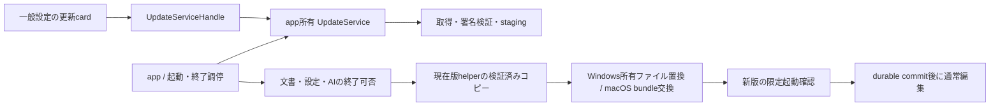

# アプリ本体更新の実装仕様

作成日: 2026-10-17
状態: 設計採用済み（PR #509）／製品は部分実装済み（U0/U1/U3はPR #512でmerge済み、U4はPR #518でDraft、U2はPR #526でDraft）／配布の有効化とOS実機試験は未完了。進捗は[引き継ぎ](application-update-implementation-handoff.md)と[Issue #510](https://github.com/hide212131/hane/issues/510)に従う
調査基準: main `e82b9a9fe42280bfa78497746bcd7e21c73430c5`（設計時点のSHAであり、current mainではない。実装時はcurrent mainで再確認する）
判断: [ADR-0034](adr/0034-zip-application-updates.md)
実装順序・受入: [引き継ぎ](application-update-implementation-handoff.md)

要求・受入条件の正本: 製品実装の現在の契約は[Issue #510](https://github.com/hide212131/hane/issues/510)。[Issue #508](https://github.com/hide212131/hane/issues/508)は設計Issueとして完了済みで、実装の受入判定には使わない。

要求の縮小記録（Issue #510の現行条件への整合）:
- restart freeze中に受け取れない外部openは、完全な再現ではなく、理由と再操作方法を利用者へ伝えることを必須とする。データ保護、更新中の安全な停止、誤った成功表示の禁止は維持する。
- restart ticketのscroll/caret保存は初回公開の必須条件から外し、位置の完全復元は後続候補とする。保存済み文書・active path・work folderの復元と、設定・AIデータの保護は維持する。
- 署名・hash・版・対象OS・配置・所有権の検査、未保存データ保護、限定health、durable commit、rollback/RecoveryRequired、Windows ExplorerとmacOS配布の制約は変更しない。

## 1. 要求と到達点

設定の「一般」に、現在のバージョンと「最新に更新する」を表示する。利用者が押すとstable releaseを確認し、新版があれば対象OSのZIPを取得・検証する。準備後に「再起動して更新」を押すと、保存状態を確認して終了し、helperがアプリ一式を置換して新版を起動する。

確認・取得だけでは再起動しない。起動時・設定表示時の自動通信、定期確認、強制更新、差分更新、prerelease channel、OS再起動、管理者権限による配置変更、全プラットフォーム追加はv1の範囲外。手動ZIP配布も残す。

完成条件は、対応するWindows/macOSの実配布物で、既存の文書・設定・AI接続・Explorer登録の状態を保ち、旧版→新版の更新と適用前の失敗からの復旧を実証すること。ダウンロード成功や新版プロセスの生成だけを更新成功にしない。

## 2. 調査で確認した現在の境界

以下は基準SHAでの事実であり、実装時にはcurrent mainで再確認する。

| 対象 | 現在の経路／設計への意味 |
|---|---|
| バージョン | root `Cargo.toml`の`workspace.package.version`が正本。現在`0.26.0`。`Cargo.lock`との整合を維持する。 |
| 配布 | `.github/workflows/windows-release.yml`がWindows/macOSをビルドしZIPを公開。既存tagでは`--clobber`可能。更新catalog・独立署名はない。 |
| Windows ZIP | rootに`hane.exe`、`hane_shell_extension.dll`、`Hane.ShellIntegration.msix`、`.cer`、信頼登録用script、README/LICENSE。展開先は任意。 |
| macOS ZIP | `hane-macos-arm64/Hane.app`とREADME/LICENSEを含む。`scripts/bundle-macos.sh`はBundle ID `io.github.hide212131.hane`を生成するが、versionキーとDeveloper ID/notarizationはない。 |
| 起動・寿命 | `crates/app/src/main.rs`がウィンドウと`AppOwnedAiService`を所有。Windowsは`open_request.rs`のpipeで同じ実行場所への起動要求を転送する。macOSを含む更新用のprocess leaseはない。 |
| 設定UI | `crates/ui/src/view.rs`の`SettingsCategory::General`、`general_settings_content`。AI/Promptsには独立した未保存の入力状態がある。 |
| 保存 | `view/session_save.rs`が既存保存・draftを担当。`flush_pending_drafts()`はwork-folderのdraftだけを書き、書込失敗を無視する。一般dirty文書を保存した証拠にはならない。 |
| 状態保存 | `FileStateStore::from_environment/root`。macOS `~/Library/Application Support/Hane`、Windows `%LOCALAPPDATA%/Hane`、診断用`HANE_STATE_DIR`。draftはwork folderの`.hane/drafts`。 |
| AI | `AiService`はapp所有でDrop時に停止・join。`ai/runtime_install.rs`は明示操作で固定版Codexを導入する別機能。本体updaterとして流用しない。 |
| Explorer | `ui/context_menu.rs`のHKCU登録・enabled markerとsparse MSIX。DLLは自身と同じディレクトリのmarkerと`hane.exe`を参照する。MSIXのversionはCargo版+`.0`。 |

関連: #22（Windows）、#312（release整理）、#309（保存境界）、#425（設定表示中の外部open）、#479/#481と設計PR #484（Codex runtime）。本体更新用の既存Issue/実装PRは調査時に見つからなかった。#297全体の完了は待たない。

## 3. 設定画面と状態

「一般」のアプリ更新cardに、現在版、確認結果、進捗、操作を表示する。開いただけでは確認しない。機械用の検証・journal・鍵IDは通常画面に表示せず、失敗時の説明と診断コードを出す。

| 状態 | 表示／利用者の操作 |
|---|---|
| `Idle` | `現在のバージョン: x.y.z`、`最新に更新する`。押すとCheckを開始。 |
| `Checking` | `更新を確認しています…`。主ボタン無効、キャンセル可能。 |
| `UpToDate` | `最新バージョンです`、`もう一度確認`。検証済みの最新版が現在版と等しい場合だけ。 |
| `Available` | `x.y.z に更新できます`、`更新をダウンロード`、`変更内容を見る`。最初の明示クリックに対する正常なCheck直後はそのままDownloadへ進めてよい。再試行では候補版を表示する。 |
| `Downloading` / `Verifying` | 取得量/総量または`更新ファイルを確認しています…`、`キャンセル`。編集・設定を閉じる操作は可能。 |
| `Ready` | `更新の準備ができました`、`再起動して更新`、`あとで`、`準備した更新を削除`。 |
| `RestartBlocked` | `未保存の文書があります。保存してから再起動してください`等の理由、`編集に戻る`、`再確認`。候補を保持する。 |
| `PreparingRestart` | 短い最終確認。書込可能なUIや新規open受付を停止。取消可能なのはhelperへ終了許可を出す前まで。 |
| `Applying` / `AwaitingHealth` | helperまたは新版の専用起動画面で`更新しています…`。通常編集はまだ開始しない。 |
| `Committed` | 新版の一般設定に`x.y.z に更新しました`を一度表示。 |
| `RolledBack` | 旧版で`更新できなかったため、以前のバージョンで起動しました`。再確認/手動取得。 |
| `RecoveryRequired` | 復旧を完了できなかったこと、旧版backupの場所と復旧操作を表示。成功表示・自動再試行ループをしない。 |
| `Failed` / `Unsupported` | 通信・検証・権限等の理由と`再試行`または`手動でダウンロード`。既存アプリの編集を継続できる。 |

Escapeや設定カテゴリ切替で進行中Downloadを暗黙取消しない。サービスはapp寿命で所有する。同時のCheck/Downloadは1件、連打は同じ操作へ集約。非同期結果は`InstallId + OperationId + CandidateId`の一致で受理し、古いCheckや取消後の進捗で現状態を上書きしない。

`CandidateId`は署名検証済みcatalog bytesのSHA-256とtargetから作る。Ready後にlatestが変わっても勝手に別版へ差し替えない。再確認で候補を変更する場合は準備済み候補を破棄する。Readyは通常終了後も保持するが、再起動時はローカル再検証だけを行い、自動適用・通信はしない。

エラーcodeは少なくとも`network_unavailable`、`rate_limited`、`metadata_missing`、`signature_invalid`、`catalog_expired`、`target_unsupported`、`protocol_unsupported`、`install_read_only`、`install_modified`、`file_in_use`、`insufficient_space`、`restart_blocked`、`rollback_failed`を区別する。HTTP 404、403/429、署名失敗を「最新です」に変換しない。

## 4. 構成と公開境界



新規`crates/update`（package `hane-update`）にmodel/catalog/verify/download/staging/lease/journal/platform adapterを置く。GPUIやdocument、AI credentialへの依存を入れない。新規`crates/updater`（binary `hane-updater`）は同libraryのローカル適用・復旧だけを呼ぶ。appが`AppOwnedUpdateService`を所有し、UIへhandleを渡す。UI module `view/app_update.rs`には描画とコマンド変換を置く。

最小の境界は次のとおり。名前は仕様上の候補で、実装で同じ責務を満たす範囲の命名変更は許す。

| API／型 | 契約 |
|---|---|
| `UpdateCommand::{Check, Download, Cancel, DiscardReady}` | app workerへ送り、I/OをUI threadで実行しない。 |
| `VerifiedCandidate` | 署名・版・target・URL制約を通した不透明型。未検証JSONからhelper planを直接作れない。 |
| `PreparedUpdate` | 検証済みstage、catalog hash、旧版identity、helper protocolを保持。ready metadataだけではこの型を再構成しない。 |
| `EditorView::prepare_update_restart` | 後述のfreeze・全session検査・draft永続化・再起動ticket作成。成功/保留理由を返す。 |
| `RestartPermit` | 検査時の全session identity/revision、設定世代、操作世代、install/candidateを束ねる一回限りの許可。保持だけで将来のquitを許可しない。 |
| `InstallLease` / `StartupGate` | 配置単位のprocess間排他。`HANE_STATE_DIR`やwindow寿命から独立。 |
| `ApplyPlan` | 固定した配置と旧/新版署名identityの組。任意destination・command・scriptを受け付けない。 |
| `UpdateJournal` | mutation intent、実ファイルidentity/hash、backup、phaseを持つ復旧正本。UI状態とは別。 |

新規依存はHTTPに`ureq` 3系（rustls、圧縮response無効）、ZIP検査に`zip`、署名検証に`ed25519-dalek`、hashに`sha2`、版比較に`semver`、JSONに`serde/serde_json`、nonceにOS乱数を使う。導入PRで公式API、Rust MSRV、feature、licenseを確認し正確な版をCargo.lockへ固定する。HTTPは専用worker上のblocking I/O、URLごとのredirectを検査する。独自暗号や独自ZIP parserは書かない。既存AI installerのshellコマンド実装・固定runtime lockを動的本体更新へコピーしない。

## 5. 発見・署名・配布契約

### 5.1 GitHubとtarget

`GET https://api.github.com/repos/hide212131/hane/releases/latest`を認証なしで使う。User-Agent、Accept、実装時のsupported API versionを固定する。Releaseの`draft=false`、`prerelease=false`、tagが`vMAJOR.MINOR.PATCH`であることを検査する。文字列比較で版順を判定しない。現在版より低い版は自動導入せず、開発版・build metadata付き版は本体更新対象外とする。

Release IDとtagに固定して`hane-update.json`と`hane-update.json.sig`を取得し、一組の署名を検証する。ZIPは同じtagの具体的URLから取得し、`latest/download`をダウンロード途中で再解決しない。重複するasset名・未upload・欠落は拒否。既存v0.26.0等にmetadataがない場合は`metadata_missing`で手動配布へ案内する。

targetは`aarch64-apple-darwin` → `hane-macos-arm64.zip`、`x86_64-pc-windows-msvc` → `hane-windows-x64.zip`。他CPUを近い名前のassetへfallbackさせない。

### 5.2 Catalog schema 1

JSONはUTF-8、256 KiB以下、重複キーを拒否する。署名は**取得したraw bytes**へdomain separator `hane-update-catalog-v1\0`を前置したEd25519署名。JSONの再serializeや空白正規化をして検証しない。署名fileは16 KiB以下の`schema`と`signatures[{key_id, signature_base64}]`。埋め込まれた信頼鍵の一つによる有効署名が必要で、未知key_idを自動登録しない。

必須項目は以下。実在しないhashを例示して本番値と取り違えさせない。

| field | 意味／検査 |
|---|---|
| `schema`, `channel`, `repository` | `1`, `stable`, `hide212131/hane`固定。未知schemaは拒否。 |
| `version`, `tag`, `source_sha` | Cargo版、`v`付き同版、ビルド対象40桁SHA。Release tagの版と一致。 |
| `catalog_sequence` | repository全体で増加するu64。既に検証して保存した最大値未満は拒否。同sequenceで異なるbytesも拒否。 |
| `published_at`, `expires_at` | UTC RFC3339。発行から最大180日、失効済み・発行が端末時計より24時間超未来なら拒否。時計異常は理由を表示し迂回しない。 |
| `updater_protocol`, `min_updater_protocol` | v1 helperが解釈できる範囲。新版がv1を必要条件として提供しない場合、手動導入へ案内。 |
| `state_compatibility` | v1は`backward-compatible-v1`のみ。旧版で読めない永続schema変更を伴う版を配布側も選ばない。 |
| `targets` | 上記targetをキーとするobject。各対象の下記値を含む。 |
| `targets.*.asset_name`, `archive_size`, `archive_sha256` | 正確な名前、実byte数、64桁lowercase hex。asset/API値とも整合。 |
| `targets.*.unpacked_size`, `layout_revision` | 実展開byte総量、下記layout revision。上限以下か検査。 |
| Windows `inventory_sha256` | ZIP内`hane-install.json` raw bytesのhash。catalogの版・targetとinventoryが一致。 |
| macOS `bundle_id`, `bundle_version`, `inventory_sha256` | Bundle ID固定、Cargo版に対応するbundle版、`Hane.app/Contents/Resources/hane-install.json`のSHA-256。`team_id`は持たない（設定されたカタログは拒否）。 |

署名鍵はHane本体更新専用とし、Codex runtime catalogの鍵/署名ドメインと共用しない。署名秘密鍵はコード・ZIP・ログへ入れず、配布用secretとして保管する。鍵値をこの設計PRでは発行しない。公開鍵は最初の更新対応版へ組み込む（macOSでもApple Team IDは使わない）。ローテーションは旧鍵で署名したbridge版に新公開鍵を同梱し、移行期間は両鍵の署名を配布する。旧鍵しか知らない版を支援する間は旧署名を残す。侵害・紛失時に安全なbridgeを出せない場合は手動導入とし、ネット上の新鍵を無条件採用しない。

最大sequenceは配置単位のprivate receiptsへ保存し、`HANE_STATE_DIR`変更で既知のsequenceを巻き戻せないようにする。保存失敗時はcandidateをReadyにしない。Readyを適用するときもcatalogの期限・sequenceと全取得物を再検証する。期限切れの古いReleaseは、同じZIP/hashのままsequenceを増やしてmetadataを再署名できる。これは配布基盤の明示操作とし、毎日起動する新しいautomationは作らない。

この信頼境界は、通信途中・Release配信データの改ざんや破損を検出するためのもの。署名秘密鍵の侵害、同じOSユーザー権限で既に任意コードを実行できる攻撃者、OS管理者による改変まで防ぐものではない。helperへの入力とjournalはこの前提でもpath/identityを検査し、任意file操作へ拡張しない。

### 5.3 通信と展開

HTTPSのみ。API hostは`api.github.com`、assetの入口は`github.com/hide212131/hane/releases/download/<固定tag>/<固定名>`。redirectは最大5回、各hopでTLSとhostnameを再検査し、GitHubのRelease配信先として許可した`release-assets.githubusercontent.com`、`objects.githubusercontent.com`の完全一致だけを追加許可する。任意の`*.githubusercontent.com`、userinfo、HTTP降格、他repoの入口URLは許可しない。配信host変更時は更新対応版の改訂または手動取得とする。

API JSON上限1 MiB、署名catalog上限は前節、ZIP上限256 MiB、展開総量上限1 GiB、entries上限10,000、1 entry上限512 MiB。署名値の宣言だけでなく実読取byte数でも制限する。connect 10秒、metadata全体30秒、Download全体15分、連続read停滞30秒。自動retryは行わず利用者へ再試行を出す。HTTP圧縮・Range/resumeはv1で使わない。Download cancelは短いread timeoutで認識し部分物を削除する。

取得はprivateな`.part`へstream書込・hash計算し、size/hash一致後に候補化する。署名・archive hash検証前は展開しない。ZIP directoryを先に全検査し、その後entryごとに安全な新規生成で展開する。

- 絶対パス、drive/UNC、`..`、NUL、Windows ADS/予約名、末尾dot/space、不正UTF-8、separator変種、同名/大文字小文字/Unicode正規化で衝突するpathを拒否。
- symlink/hardlink/reparse point、暗号化、多重volume、device file、許可しないcompression方式を拒否。v1配布物にlinkを入れない。特殊permission/setuidを落とし、必要な通常実行bitだけを復元。
- stageの既存entryをたどらない。path検査と書込時のno-follow/identity確認を併用し、stage外に書かない。検証後も使用直前に対象identityを再確認する。
- 許可root、必須ファイル、余分な実行物、inventoryを検査する。macOSの`__MACOSX`等を無制限に受容せず、配布側でupdate対応ZIPに混入させない。
- 必要容量はdownload、stage、現在版backup、journal余裕64 MiBを各volumeで見積もる。容量不足や利用者quotaは更新前に失敗させる。write途中の不足もrollback対象にする。

## 6. 配置、所有権、bootstrap

インストール先は`current_exe`と検証済み配置から決める。API/catalog/CLI引数が書込先を指定できない。Windowsはexeの親、macOSは構造・Bundle ID検査を通した`.app`が対象。別名exe、開発用cargo出力、app外の裸macOS binary、network/share/removable配置は自動適用しない。v1はWindows NTFS、macOS APFSのローカルvolumeに限定し、対応外なら手動案内する。

通常の実行ユーザーの権限で、対象と親に必要なcreate/replace/deleteが可能なことを実際の一時ファイル操作で確認する。管理者としてhelperを再起動しない。インストールのownerと実行ユーザーが異なる場合は自動更新不可。macOSのApp Translocation/read-only volumeではアプリを移動して再起動するよう案内し、隔離属性を消したり別名の実体を推測して書き換えたりしない。

`InstallId`はOS、volume identity、正規化した配置path、owner identityから決める。operationは配置の旧file IDも保持し、途中でmove/replaceされれば拒否する。別の配置のHaneを更新しない。`HANE_STATE_DIR`変更で同じ配置のleaseが分裂しないよう、起動排他の正本は配置の親にある`.hane-update-<InstallId>/`に置く。lock directory/fileは他ユーザーの通常起動でもleaseを取得できる読取権限を持たせ、所有者以外の書込を禁止する。privateなstage、journal、ticketは所有者だけが読書きできるsubdirectoryに置く。既存の別owner/link/不明内容の同名directoryは採用しない。

配置親にcoordination directoryを作れない場合は本体更新不可とし通常編集を許す。ただし既にpending mutationが記録された配置では起動調停を迂回せず、復旧を先に行う。設定データ保存先が不明・memory fallbackしか使えない場合も更新不可。

```text
<Hane state root>/updates/<InstallId>/
  candidates/<CandidateId>/     # download、catalog、署名、ready情報
<配置親>/.hane-update-<InstallId>/
  startup.lock                 # 短い起動調停／helperのhandoff中保持
  runtime.lock                 # 各実行プロセスのshared lease
  transaction.lock             # updater/helperのexclusive lease
  private/<TransactionId>/     # 同volumeのstage、backup、journal、現在版helper copy
  receipts/                    # 検証済み旧inventory等。private permission
    seen-catalog.json          # 配置単位の署名済み最大sequenceとhash
```

macOSでは`.app`外にhelper copyを置く。Windowsでも更新中の`hane-updater.exe`そのものを上書きしない。コピーは現在版の署名/所有inventoryから検証し、copy後に再検証して実行する。未検証の新版helperを適用開始前に実行しない。

最初の更新対応版を`V_bootstrap`と呼ぶ。具体的な版はリリースPRのCargo版から確定する。既存版→`V_bootstrap`は一度手動ZIP導入し、旧版の終了・ファイルの退避を案内する。以後は署名metadataとhelper protocolを持つ版同士で更新する。移動/コピーしたアプリは新InstallIdになり、旧配置のReadyやjournalを引き継がない。

## 7. 再起動前の文書と設定の契約

Download中は通常編集できる。「再起動して更新」は次の順序で行う。

1. Readyを再検証し、配置・容量・権限と現在版identityを確認する。失敗時はまだ何も終了しない。
2. UI thread上で短いrestart freezeを設け、新規編集、外部open、folder切替、設定変更、save/rename/AI開始を止める。既に届いたexternal openを失わず、開始前なら処理後に再判定する。freeze後に受け取れない外部openは、更新中で開けない理由と再操作方法（更新完了後にもう一度開く）を利用者へ伝える。送信元プロトコルが許す場合はbusy/再試行も返す。新規キューを通常起動の成功として消費せず、開けていないのに成功と見せない。
3. 全ウィンドウ・全sessionについてidentity/revision、dirty、save/rename/autosaveのpending、modal/Save As、AIの選択文章処理/認証/導入/設定保存、AI/Prompts未保存フォームを検査する。IME composition中も保留。macOSで別processが同じ配置を使っていれば後述leaseで適用を拒否する。
4. dirty文書や未保存フォームがあればfreezeを解除し、利用者が既存の保存操作へ戻れるようにする。強制保存、未保存内容の破棄、Save Asの自動決定をしない。v1にSave Allを新設しない。空で変更のない初期Untitledは妨げない。
5. draft flushは新しい`Result`付きの更新用経路で全件成功を確認し、設定・recentの必要な永続化、下記ticketのatomic write/fsyncを確認する。既存のbest-effort通常quit処理の動作はこの機能で一律変更しない。書込失敗はfreezeを解除して保留。
6. 全identity/revision/世代が依然同じことを再検査して一回限りの`RestartPermit`を作る。helperを準備し、helperが起動gateを確保して`Prepared`を返すまで通常終了しない。
7. quit直前にpermitの鮮度を確認する。AI serviceへ明示shutdown/join完了を要求し、draftの遅延jobをdrain/cancelする。停止が10秒以内に完了しなければhelperへAbortし、旧版を保持する。サービスを停止した場合は旧画面へ戻るときに再初期化する。process killで終了を達成しない。
8. helperへ`ExitAuthorized`を送り、通常quit。helperは親processのOS handle/exit notificationを30秒まで待ち、単なるPIDの消滅推測では判定しない。親が残ればmutationせずAbortする。

`restart-ticket.json`にはschema、TransactionId、InstallId、元のstate root、work folder、開いていた**保存済み**ファイルの順序、active pathを保存する。scroll/caretの保存・復元は初回公開の必須条件ではなく、後続候補とする。文書本文、秘密、任意コマンド、任意環境変数は保存しない。通常起動のdefault folder設定を書き換えない。再起動後は現在のdisk内容を既存open経路で読み、移動/削除済みは失敗を表示して残りを開く。未保存本文をticketで復元する設計にはしない。

restart blockerが一つでもある場合、helperの起動・適用へ進まない。フリーズは短い検査と終了調停の間だけに限定し、通信・hash・ZIP展開をその中で行わない。

## 8. 起動調停とhelper protocol 1

PID fileの存在だけでは排他しない。OSのprocess lifetime付きfile lockを使い、順序を`transaction → startup → runtime`に固定する。起動時は`startup`を短く取り、pending journalを確認してから`runtime`のshared leaseを取得し、`startup`を解放する。runtime leaseはwindow close後もprocess終了まで保持する。既存Windows open-request pipeはこのleaseの代替にならない。

helperはtransactionを保持した上でstartup gateを取得し、現在版へPreparedを返す。親の終了後runtimeのexclusive leaseを取得する。別のHane processが残ればmutationを行わず、gateを解放して旧版を起動し、他のHaneを閉じるよう表示する。新規の通常起動はgateで待機し、最大30秒で「更新中」を表示して終了する。外部ファイル引数を更新成功として破棄しない。外部openの送信元がbusyを扱えないFinder/Explorerの場合は、要求したpathを開けなかったことと更新後の再操作を利用者へ通知する。

親とhelper、新版の限定起動は、明示的に継承させたprivate pipe/handleとOS乱数256-bit nonceで対応付ける。公開CLI flagやTransactionIdだけでfreeze・起動gate・healthを迂回できない。handleを他の子へ漏らさず、実parent/child identityも確認する。引数は構造化して渡し、shell経由で展開しない。helperは最小のOS環境だけを受け、認証情報や環境全体をticketへ複製しない。元の検証済みstate rootを新版へ明示し、`HANE_STATE_DIR`利用時も別の設定で誤起動しない。

helperは適用直前に署名、候補hash、旧identity、期限、stage内容をローカル再検証し、apply planをjournalへdurableに記録する。適用中のCancelは受けず、失敗時はrollbackへ進む。helper自身の起動や事前検査に失敗した場合、親はquitしない。

新版の限定起動だけはprivate capabilityでstartup gateを通れる。helperはmutation完了後にruntime exclusiveを解放し、新版はshared leaseを取る。startup gateはcommit/rollbackまでhelperが保持する。新版は署名された版・実exe identity・TransactionId・catalog hashを確認し、永続データの変更を無効にした状態で初期window/描画を立ち上げ、設定とticketをread-onlyで検査する。AI service、autosave、migration、外部open、通常編集はまだ開始しない。Windowsは明示した継承handle付きのCreateProcess、macOSは正規bundleの`Contents/MacOS/hane`へ継承pipeを渡すposix_spawn相当を使い、OS process identityを保持する。LaunchServicesに既存processの再利用を任せて、別processのhealthを誤受理しない。

45秒以内にその実childから`Healthy`を受けたら、helperが`Committed`をfsyncしてから新版へ`Commit`を返す。新版はここで通常の文書復元とサービス開始を行う。healthは限定起動が成立した証拠であり、AI接続成功・全製品機能・将来のクラッシュを保証しない。

health不成立なら専用の非編集childへ終了要求を送り、そのchildが終了しruntime leaseが空くことを確認してrollbackする。childを安全に停止できない場合は旧版で上書きせず`RecoveryRequired`。他processをkillしない。helper死亡時のchildは、同じtransactionのdurable Committedを確認できた場合だけ通常開始できる。それ以外は非編集のまま終了して復旧経路へ移る。

## 9. Windows適用とExplorer連携

### 9.1 layout revision 2

Windows ZIPはroot展開を維持し、以下を追加/変更する。

```text
hane.exe
hane-updater.exe
hane-install.json
hane-install.json.sig
Hane.ShellIntegration.msix
Hane.ShellIntegration.cer
Trust-HaneShellCertificate.ps1
shell-integration/<version>/hane_shell_extension.dll
README.md
LICENSE
```

`hane-install.json`はversion/target/source_sha/updater_protocol/layout_revisionと各所有ファイルのrelative path、size、SHA-256を持つ。自身と署名file以外の配布ファイルを列挙し、domain separator `hane-install-v1\0`で署名する。自己hashやZIP hashを同じJSONに入れない。catalogがこのinventoryのhashとZIP hashを結び付ける。署名済みinventoryとsignature自体は固定名の管理ファイルとして別に置換・backupする。

現在のexe/helperのhashが旧署名inventoryと一致しない場合は開発/改変配置として自動適用しない。旧版/新版の一覧を比較し、同名の未知ファイルや改変ファイルに衝突すれば停止する。利用者のMarkdown、enabled marker、任意の隣接ファイルをbackup/remove対象にしない。

### 9.2 ファイル置換

全fileの検査とbackupを先に作成・flushする。各mutationのintentと旧/新hashをjournalへflushしてから、同volume上のnative replace/renameを行い結果を記録する。`hane.exe`は最後にatomic replaceし、起動時にexeが存在しない窓を作らない。新品file作成はno-replaceで衝突を拒否する。複数file全体が原子的とは主張せず、startup gateと復旧journalで混在版の通常起動を防ぐ。

Windowsの通常起動入口は、app資源・state・AIを開く前にpending transactionを検出し、検証済みrecovery helperへ渡す。新helperと旧helperはprotocol 1を理解できなければ候補不可。電源断等で一部fileだけ新版になっても、journalのwrite-intentと実hashを照合して旧一覧に戻す。

rootの使用中exeやAntivirus等による共有違反は短い再試行（最大3秒）の後にrollbackする。`MOVEFILE_DELAY_UNTIL_REBOOT`、Explorer kill、証明書自動信頼、管理者権限は使わない。バックアップ復元も同じhash/identity検査を行い、第三者の変更を上書きしない。

### 9.3 Explorer DLLを上書きしない

MSIXの`com:Class/@Path`を`./shell-integration/<version>/hane_shell_extension.dll`へ変更し、`Application/@Executable`とExternalLocationはrootの`hane.exe`/配置を維持する。C++ DLLは決められた二階層上のrootから既存enabled markerとexeを解決する。任意pathを記した新しい設定fileは導入しない。rootのmarker名・内容・HKCUの所有チェックは維持する。

新版DLLは新規pathなので旧DLLのlockに影響されない。旧root DLLおよび旧versionのDLLはv1の自動削除対象から除外する。未知fileとして巻き込まず、登録中/ロード中の世代を削除するGCは別作業とする。

本体commit後、更新前に登録が有効だった利用者だけ既存の所有チェックを通して新MSIXへ更新する。再起動ticketには更新前の検査済みpackage identity/ownerとfile/folder各ON/OFFを保存し、新版のpackage version不一致だけで「未登録」と誤判定しない。未登録を勝手に登録せず、他ownerの登録を変更せず、各markerのON/OFFを保つ。Publisherが変わる版は連携の自動再登録をせず、別途の明示的な信頼設定へ案内する。

MSIX更新失敗は`本体は更新しましたが、Explorer連携の更新に失敗しました`として設定に修復導線を出す。旧DLLと登録を残し、core commitを偽の失敗に戻したり、登録成功と表示したりしない。古いDLLから新版exe、及びrollback先exeへの「1つのfile/folder引数」の呼出契約を維持する。これを壊す版はprotocol 1では配布しない。

## 10. macOS適用

出荷前提は、`.app`内の`Contents/Resources/hane-install.json`と`.sig`（更新用Ed25519鍵で署名したinventory。自身と`.sig`以外の全ファイルのパス・size・SHA-256を`Hane.app`相対で列挙）を含めること。Apple Developer ID・固定Team ID・notarizationは要求しない。Info.plistに`CFBundleShortVersionString`/`CFBundleVersion`（Cargo版）、`HaneSourceCommit`（40桁source SHA）、`HaneUpdaterProtocol`（整数1）を設定する。現在版と候補のBundle ID、版、source SHA、署名済みinventoryとbundle内ファイルの一致を確認する。inventoryのない既存版は手動で`V_bootstrap`を導入する。

ZIP layout revision 1は`hane-macos-arm64/Hane.app`とREADME/LICENSEに限定する。inventory署名後にbundleを加工しない。候補helper/実行fileも同じ署名済みinventoryで検証した内容と一致することを確認する。Appleの署名をカタログ・inventoryの署名の代わりにせず、Appleの署名がないことも拒否理由にしない。

helperは`.app`外のprivate stageから、配置pathと同じAPFS volumeにある検証済みcandidateと現bundleを`renamex_np(RENAME_SWAP)`相当の原子的交換で入れ替える。APFSであることに加えてvolumeのswap-renaming capabilityを検査する。先に元bundleを消す二段階renameへfallbackしない。交換後の旧bundleをbackupとして保持し、限定起動失敗時は同じ交換で戻す。file IDとcatalog/版をjournalに照合して方向を決め、journal更新直前に中断しても交換を二度適用しない。

APFS以外、交換非対応、App Translocation、読取専用や親の権限不足なら適用せず手動案内する。Gatekeeperを無効化したりquarantineを削除したりad hoc再署名したりしない。OSが未署名・未公証のappの起動を確認する場合は、本人がアプリ単位で起動を許可して進める。起動は正規配置のbundleから行い、private health channelを実childへ渡す。OSの起動拒否はhealth失敗として旧bundleを維持/復旧する。

## 11. Journal、復旧、cleanup

phaseは`Prepared → ExitAuthorized → Applying → AwaitingHealth → Committed`。失敗系は`RollingBack → RolledBack`または`RecoveryRequired`。UIのDownload/Readyはjournalの適用許可を意味しない。

journalはschema、TransactionId、InstallId、source/destinationの署名identity、旧/新catalogまたはinventory hash、各fileのplanned/applied状態、旧/新file ID、backup、ticket hashを持つ。relative pathを原則とし、保存済みの絶対pathだけを信用して任意fileへ操作しない。write-temp → fsync → atomic rename → parent directory flushの順で更新する。OSが提供するdurabilityを超えた電源断保証は主張せず、実disk状態との照合を必須とする。

| 中断/失敗点 | 再開時の決定 |
|---|---|
| Download/展開/Ready | 現版をそのまま起動。未完part/stageを安全に破棄できる。適用しない。 |
| Prepared、親が稼働中/ExitAuthorized未達 | mutationなし。helperが死んでいれば旧版を継続。 |
| ExitAuthorized、mutation前 | 旧版が一致すれば旧版起動。自動適用を再送しない。 |
| Applying途中 | lease確保後、intentとfile hashを照合して旧版へrollback。新版の通常起動をしない。 |
| AwaitingHealth、commitなし | 対象childの終了を確認しrollback。新版に永続書込を許さない。 |
| durable Committedあり | 新版を維持しticketを一回だけ処理。確認後の再起動で勝手に旧版へ戻さない。 |
| backup破損、未知hash、root移動、復元不可 | `RecoveryRequired`。追加削除・旧新どちらかの推測による上書きをしない。公式GitHub Releasesの署名済みZIPを、現在のインストール先とは異なる書き込み可能な場所／名前へ展開する手動導入へ案内する（同じ場所への上書きはInstallIdとjournalが残り再び止まるため案内しない）。元のフォルダー、`.hane-update-*`、journal、表示されたbackupは変更しない。カスタム`HANE_STATE_DIR`は引き継ぎ、Explorer連携は設定画面で確認する。 |

pendingを見た最初の起動は同じtransactionの現在版helper copyを検証して復旧し、必要なら独立helperの進捗/復旧画面を出す。起動側はruntime leaseをまだ取らず、startup gateを解放してからrecovery helperへ渡し、そのhelperが順序どおりtransaction/startup/runtimeを取る。gateを保持した親がhelperのgate取得を待つdeadlockを作らない。同時に複数の復旧要求が来てもtransaction leaseを取った一つだけが操作する。rootにアプリが残ることを前提にし、起動可能な場所を消す設計にしない。helper入口は対話のない任意ディレクトリ置換toolにしない。

Committed後にcandidate/backupを急いで消さず、次の正常起動を1回確認してから当該transactionの検証済み所有物だけを削除する。cleanup失敗は`cleanup_pending`として次回に再試行し、更新成功を取消さない。旧shell DLLの保留は前節に従う。journal/receipt/診断履歴は直近3transactionまで残す。未知dirやsymlinkを再帰削除しない。

診断は版、target、phase、診断code、transaction識別子、取得可能なOSエラーを記録する。文書内容、AI token/API key、URL queryの署名token、ticket内の文書pathを通常ログへ出さない。OS通知・利用者の連絡先へ外部送信する機能は追加しない。

## 12. 配布側の変更契約

配布基盤専用PRは既存release入口・Cargo version整合・全workspace checksを維持し、以下を行う。

1. 両OSでhelperをビルドし、version/source/target/protocolを実binaryから検査する。Windowsはinventoryを生成・署名し、macOSも`Hane.app`内にinventoryを生成・署名してからZIPを作る（Apple署名・notarizationは要求しない）。
2. inventory/ZIP検査後に実size/hashを集計し、両targetを含むcatalogを生成・署名する。更新用の鍵IDは保守者が実値を設定し、未設定ならrelease準備を失敗させる。空署名/開発鍵で代用しない。
3. Draft Releaseへ両ZIP、catalog、signatureをuploadし、再取得して検証した後にstable公開する。公開済み同tagのZIPはclobberしない。修正は新しいCargo版で出す。metadataの期限更新だけは同じarchive hashで行える。
4. `release-request.yml`の完了確認を、両ZIPの存在に加えてcatalog/signature/版/署名/hash一致まで拡張する。Releaseの公開とsource SHAの対応を保つ。
5. bootstrapの手動導入、supported配置、macOSの起動許可、保存が必要なときの画面、手動復旧をREADMEへ反映する。現在のportable Windowsの方針をMSIX全体インストールへ読み替えない。

通常product workerに`.github/`やtrusted policyを変更させない。署名secrets設定・Appleの外部審査・実配布を設計のチェック済み事項に含めない。

## 13. 参照と未実施の境界

- [GitHub Releases REST API](https://docs.github.com/en/rest/releases/releases): stable Releaseとassetの取得。
- [Microsoft: Moving and Replacing Files](https://learn.microsoft.com/en-us/windows/win32/fileio/moving-and-replacing-files): open fileの共有条件等。
- [Microsoft: Explorer context-menu integration](https://learn.microsoft.com/en-us/windows/apps/desktop/modernize/integrate-packaged-app-with-file-explorer): DLL/sparse packageの外部配置。
- [Apple: Packaging Mac software](https://developer.apple.com/documentation/xcode/packaging-mac-software-for-distribution): ZIP・初回/upgrade・translocationの確認。
- [Apple: volumeSupportsSwapRenaming](https://developer.apple.com/documentation/foundation/urlresourcevalues/volumesupportsswaprenaming): volumeの`RENAME_SWAP`対応確認。
- [Apple: Developer ID](https://developer.apple.com/developer-id/)、[Notarization](https://developer.apple.com/documentation/security/notarizing-macos-software-before-distribution): 配布の署名とnotarization。
- [ureq](https://docs.rs/ureq/latest/ureq/)、[zip](https://docs.rs/zip/latest/zip/)、[ed25519-dalek](https://docs.rs/ed25519-dalek/latest/ed25519_dalek/): 導入候補の公式API。

本仕様は上記current sourceと公開仕様の調査による設計である。APFS交換、Windowsの共有違反/実MSIX登録、実署名・notarization、二版の実更新、停電相当の故障注入、GUI/保存回帰は未実施。[引き継ぎの受入表](application-update-implementation-handoff.md)を実装時に満たす。
