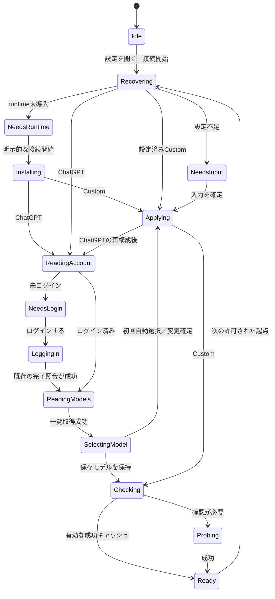

# Issue #724 設計（採用版）

## 司令塔による修正（Jev 判断、2026-11-13）

ドラフト（Codex GPT-6.1 Sol / medium）の個別判断は Jev で支持された（設定画面を開いての自動 probe 0.63／推奨モデルの自動保存 0.75／runtime 導入の開始ボタン統合 0.82）が、一括採用は 0.49 と弱かったため、フェーズを分けて採用する（Jev のフェーズ分け判断: P1 絞り込み 0.99）。

- **P1（今回）**: ChatGPT 経路の自動化に絞る。起点連鎖と接続準備の状態機械、状態取得・モデル一覧の自動化、推奨モデルの自動選択と自動保存、probe 自動実行と10分キャッシュ、ChatGPT 節のボタン削除（状態を更新・モデル一覧を更新・応答を確認）、段階別の失敗表示。オーナーが名指しした3ボタンは P1 で全て解消する
- **P2（後続）**: runtime 初回導入の開始ボタン統合、Custom 初回入力の改善（未登録キーの入力欄を最初から表示）、仕様 HTML の改訂
- P1 でも仕様文書のうち `docs/ai-settings-oauth-implementation-spec.md` と `docs/ui/ai-settings/README.md` の「自動化に伴う契約差分」は設計書の差分表どおり最小限更新する（HTML 仕様の改訂は P2）

以下はドラフト本文（フェーズ分けと P2 送りの項目については本修正が優先する）。

---

# Issue #724 AI設定画面の自動接続準備 設計書

## 概要

ChatGPT接続は、原則として「ログインする」だけで、状態取得・推奨モデルの選択と保存・応答確認まで進むようにする。ログイン済みなら、AI設定画面を開くだけで準備する。

通常画面には接続状態と選択モデル、確認結果を表示する。手動更新ボタンは通常経路から除き、モデル変更・再ログイン・切断・失敗時の再試行を残す。

| 条件 | 利用者の操作 | 自動処理 |
|---|---|---|
| ChatGPT・未ログイン | ログインする | 状態取得 → モデル決定 → 必要なら保存・適用 → probe |
| ChatGPT・ログイン済み | AI設定を開く | 状態取得 → モデル確認 → 必要な場合だけprobe |
| APIキー・初回設定 | 必須項目を入力し「接続する」 | 保存・適用 → probe |
| 設定済み接続への切替 | 接続方式を選ぶ | 保存・適用 → 接続準備 |
| 接続準備に失敗 | 原因に対応する操作を選ぶ | 失敗段階から必要な処理を再開 |

「画面を開く」「ログインする」「接続設定を確定する」を、接続準備の自動通信を許可する文脈とする。アプリ起動・通常の文書編集・未確定の入力からは開始しない。

調査基点はローカルHEAD `fe715608b131521c114446cab106cb41aa43b829`。ローカルの `origin/main` も同じSHAである。リモートmainとの最新の一致は未確認。[Issue #724](https://github.com/hide212131/hane/issues/724) の本文は取得して照合した。

本書は設計提案であり、製品コード・仕様ファイルは変更していない。以降、**新設予定の型・関数名は「案」**として記載する。

## 現状の接続点（ファイルと行の根拠）

以下の行番号は調査基点に対応する。

| ファイル・行 | 実在するシンボル | 確認した事実と設計への接続 |
|---|---|---|
| `crates/ui/src/view/ai_settings.rs:362`（ai_settings.rs:362） | `AiSettingsPage::begin_settings_session` / `close_settings` | UIの入力状態を初期化・解放する。画面を閉じてもサービス所有のOAuth・probeは取り消さない |
| 同ファイル:401 | `AiSettingsPage::activate` | `AiCommand::OpenSettings` を送る。Busyなら既存処理を継続する |
| 同ファイル:303、431 | `attach` / `apply_snapshot` | サービスのsnapshotを購読する。自動連鎖の実行主体を描画処理に置く必要はない |
| 同ファイル:755、798 | `draft_settings` / `save_inner` | draftの保存、キー操作、削除確認などの入口 |
| 同ファイル:1676、1718 | `current_connection_message` / `current_next_step` | 手動の状態更新・probeを促す文言がある |
| 同ファイル:2181 | `chatgpt_account_content` | ログイン・状態更新・ログアウトは、保存済みChatGPT接続かつcleanな状態を前提とする |
| 同ファイル:2401 | `chatgpt_model_controls` | 一覧取得・選択は別操作。選択はInputStateの変更に留まり、保存が必要。一覧表示は先頭40件に制限される |
| 同ファイル:2770 | `custom_key_content` | 未登録キーも「登録」を押してから入力欄を開く |
| 同ファイル:3073、3230 | `probe_section` / `probe_disabled_reason` | 手動probe、取消、実通信・利用枠消費の説明、保存・適用・所有権などの制限がある |
| `crates/ui/src/view/settings_screen.rs:122`（settings_screen.rs:122） | `EditorView::select_settings_category` | 接続カテゴリへ移る際に `activate` を呼ぶ |
| `crates/ai/src/service.rs:208`（service.rs:208） | `AiCommand` | 状態取得・モデル取得・probe・導入などの既存コマンドがある |
| 同ファイル:865、2707 | `handle_command` の `OpenSettings` 分岐 / `open_settings` | 所有権取得・journal復旧・設定再読込を行う。ここでは `account/read` を呼ばない |
| 同ファイル:938、1046 | `RefreshAccount` / `RefreshModels` 分岐 | 既存の状態取得・モデル取得経路。ChatGPTが保存済みのactive接続である必要がある |
| 同ファイル:3390 | `finish_login_reconciliation` | **ログイン完了後は既に `account/read` と、SignedInの場合のモデル一覧取得を実施している** |
| 同ファイル:2478 | `finish_persisted_save` | 保存と適用の結果を区別する。モデル変更はruntime再構成につながり得る |
| 同ファイル:1253、1744 | `run_probe_command` / `probe_model_checked` | 保存済みモデル、資格情報、復旧状態を検査してprobeを実行。ChatGPTモデルは取得済み一覧への存在が必要 |
| 同ファイル:3605 | `mutate` | 成功probeの世代・接続・モデルが変わると `Stale` にする |
| 同ファイル:666、1447 | `AiService::apply_network` / `publish_probe_execution` | network revisionを管理し、古いnetwork条件での成功公開を防ぐ |
| `crates/ai/src/models.rs:15`（models.rs:15） | `ChatGptModel` / `fetch_chatgpt_models` / `saved_model_is_available` | `is_default` が存在する。hidden・text非対応を除外し、ページングして候補を取得する。保存・推論に使う値は `id` ではなく `model` |
| `crates/ai/src/settings.rs:38`（settings.rs:38） | `ChatGptConnectionSettings` / `AiSettings::default` | 初期接続はChatGPT、モデルは未設定。`revision` と `settings_generation` は別の責務 |
| `crates/ai/src/probe.rs:22`（probe.rs:22） | `PROBE_PROFILE_VERSION` / `PROBE_INPUT` / `ProbeResult` | 文書を含まない固定入力、90秒の期限、結果に結び付く世代情報がある |

Custom接続には、今回確認した `CustomConnectionSettings`、`provider.rs`、サービスの接続経路に、候補一覧や推奨モデルの仕組みはない。ChatGPTの `model/list` をCustomへ流用しない。

## ボタン棚卸し表

対象は `crates/ui/src/view/ai_settings.rs` の全 `Button::new` と、接続選択・メニュー項目・入力による手動ステップ。IDの共通接頭辞も省略せず示す。

| 現行操作・ID／行 | 分類 | 変更内容と理由 |
|---|---|---|
| AI状態再確認／復旧 `ai-settings-retry-open` :941 | 残す | 所有権・復旧失敗時だけ表示。通常表示時の復旧開始は自動 |
| 導入 `ai-runtime-install` :1149 | 文言・配置変更 | 初回の接続開始へ統合する。導入失敗時は「再試行」として残す |
| 導入取消 `ai-runtime-install-cancel` :1135 | 残す | 接続準備中の取消へ統合 |
| 適用再試行 `ai-settings-retry-apply` :1339 | 残す | 適用失敗時だけ表示。成功後は自動で接続準備を再開 |
| 診断開閉 `ai-diagnostics-toggle` :1565 | 残す | 補助情報を開く判断。通常画面の下部に配置 |
| 接続方式Radio 2件 :1904、1952 | 文言・動作変更 | 設定済みの接続は選択で確定。未設定Customは入力へ進む |
| 切替時の破棄 `ai-connection-switch-discard` :2032 | 残す | 未保存入力を失う判断が必要 |
| 切替中止 `ai-connection-switch-cancel` :2043 | 残す | 編集継続を選べるようにする |
| 確認実行 `ai-confirmation-confirm` :2092 | 残す | 切断・キー削除の影響を確認する |
| 確認中止 `ai-confirmation-cancel` :2113 | 残す | 破壊的操作を中止する |
| ログイン `ai-chatgpt-login` :2232 | 残す | 通常経路の唯一の開始ボタン。ログイン済みではアカウント操作内に再ログインを用意 |
| ログイン取消 `ai-chatgpt-cancel-login` :2251 | 残す | 接続準備全体の取消として表示 |
| 状態更新 `ai-chatgpt-refresh-account` :2269 | 削除（自動化） | 表示時・ログイン完了時に取得。取得失敗時だけ文脈に沿った再試行を表示 |
| ログアウト `ai-chatgpt-logout` :2286 | 文言・配置変更 | 「切断」としてアカウント操作内へ移す。影響確認を維持 |
| モデル選択 `ai-chatgpt-model-picker` と各項目 :2440、2452 | 文言・配置変更 | 通常は選択済みモデルを表示し、「変更」から一覧を開く。初回の必須操作から除外 |
| モデル一覧更新 `ai-chatgpt-refresh-models` :2482 | 削除（自動化） | 通常は自動取得。失敗時の再取得と、変更メニュー内の更新操作は残す |
| Custom詳細開閉 `ai-custom-details-toggle-button` :2621 | 残す | 接続先などの詳細を編集する場合だけ開く |
| サービス選択 `ai-custom-service-picker` とOpenAI／その他項目 :2710以降 | 残す | 接続先を選ぶ判断が必要。プリセット選択だけで送信しない |
| キー登録／変更 `ai-custom-key-replace` :2782 | 文言・動作変更 | **未登録時の「登録」は削除**してmasked入力を最初から表示。登録済みの「変更」は残す |
| キー削除 `ai-custom-key-delete` :2799 | 残す | 資格情報を失う判断が必要 |
| 削除予約取消 `ai-custom-key-undo-delete` :2819 | 残す | 確定前に取り消せるようにする |
| キー変更中止 `ai-custom-key-cancel` :2851 | 残す | 入力を破棄し既存キーを保持する |
| probe取消 `ai-probe-cancel` :3092 | 残す | 自動通信も利用者が中止できるようにする |
| probe開始 `ai-probe-run` :3110 | 削除（自動化） | 通常画面には結果だけ表示。失敗時は「再試行」、診断内には任意の「再確認」を置く |
| 保存 `ai-settings-save` :3342 | 文言・表示条件変更 | 初回Customは「接続する」、変更時は「変更を適用」。初回の推奨モデル選択では表示・操作不要 |
| 破棄 `ai-settings-discard` :3350 | 残す | 未保存の手入力がある場合だけ表示 |
| 保存して移動 `ai-settings-save-and-leave` :3467 | 残す | 手入力のdirty離脱に限定。接続準備完了待ちとは分ける |
| 破棄して移動 `ai-settings-discard-and-leave` :3475 | 残す | 未保存入力の破棄判断 |
| 編集継続 `ai-settings-continue-editing` :3492 | 残す | dirty離脱の中止 |
| ChatGPTモデルID手入力 :2530付近 | 文言・配置変更 | 詳細へ移す。一覧外モデルの保存値は保持するが、現行の一覧存在チェックを迂回しない |
| Customモデル・名前・URL・キー入力 | 残す | 未完成の入力を自動保存・送信しない。確定操作は一つにまとめる |

L3218付近の「応答を確認」は見出しであり、別のボタンではない。見出しは「接続状態」へ変更する。

## 設計判断（各判断に理由）

**1. 自動連鎖は `AiService` が所有する。**

`AiSettingsPage::render` やsnapshot受信ごとに次のコマンドを送る方式は採用しない。再描画、通知の集約、複数画面からの表示で二重起動しやすいためである。

既存worker内に接続準備の進行状態を追加する。純粋な遷移判断は新規 `crates/ai/src/connection_preparation.rs`（案）へ置き、I/Oは既存サービス・認証・保存・probe経路で実行する。別のランタイムや汎用workflow基盤は追加しない。

ログイン完了時は `finish_login_reconciliation` の取得結果を引き継ぐ。同じ `account/read` と `model/list` を直後に再送しない。

**2. 自動通信の範囲を、利用者が接続を準備している文脈に限定する。**

許可する起点は次のとおり。

- AI設定カテゴリを開く。
- ログインを開始し、その照合が完了する。
- 接続方式・モデルの選択を確定する。
- APIキー等の変更を適用する。
- 失敗表示から再試行する。

単なるアプリ起動、通常の文書編集、入力途中、タイマー経過だけでは開始しない。非active接続を調べるために別runtimeを起動しない。

画面には次を常時読める位置に表示する。

> 接続の準備と確認を自動で行います。確認には短いテストメッセージを使い、文書は送信しません。利用料金・利用枠を消費する場合があります。

追加の同意ボタンは設けない。設定画面を開く文脈で自動化してよいというオーナー方針に基づく。

**3. 推奨モデルは既存の `is_default` を使い、保存済みモデルを優先する。**

優先順位を次のように固定する。

| 優先 | 条件 | 処理 |
|---|---|---|
| 1 | 利用者がモデル変更を確定した | 指定した `model` を保存・適用する |
| 2 | 保存済みモデルが候補一覧に存在 | そのモデルを保持する |
| 3 | 保存済みモデルがあるが一覧に存在しない | 保持して停止。「保存済みモデルを利用できません」と変更操作を表示 |
| 4 | 保存済みモデルがなく、`is_default == true` の候補がある | 最初の該当候補を自動選択 |
| 5 | 保存済みモデルがなく、default指定もない | 全ページ取得後の候補先頭を自動選択 |
| 6 | 候補が空／取得失敗 | 自動保存・probeをせず、理由と再取得操作を表示 |

候補は `fetch_chatgpt_models` が返すhidden・text対応条件を通過したものに限定する。UIの先頭40件制限は自動選択に使わない。

複数defaultの場合は返却順で最初を選ぶ。defaultのない先頭候補は「サービスの推奨」と断定せず「自動選択」と表示する。製品側に特定モデル名を固定しない。

初回の自動選択はdraftへの記入だけで終えず、既存の保存経路で永続化・適用する。追加の「保存」を押させないためである。保存時は最新設定のモデル項目だけを変更し、`expected_revision`、所有権、journal、耐久性確認を維持する。

保存・適用が失敗したら停止し、probeへ進まない。モデル保存でruntimeが再構成された場合は、新runtimeの状態・認証・モデル候補を確認してからprobeへ進む。

**4. 変更の確定と、未完成の入力を区別する。**

cleanな画面でのモデル一覧選択は、それ自体を変更確定操作とする。「変更」→モデル選択の後に保存ボタンを要求しない。

設定済み接続へのRadio選択も、切替の確定操作とする。ChatGPTはモデル未設定でも切替を保存でき、その後ログイン・自動モデル選択へ進める。

一方、Customの初回入力やURL・モデルIDの手入力はdraftを維持する。キー入力の途中やblurで自動送信しない。入力完了後の「接続する／変更を適用」一操作で保存と接続準備を開始する。

既に他のdirty入力がある場合、モデル選択だけでそれらを一緒に保存しない。draft編集として扱い、既存の適用・破棄操作にまとめる。

**5. 初回runtime導入も接続開始へ統合する。**

現行 `AiCommand::InstallRuntime` は「明示的な導入ボタンからのみ実行」と定義されている。そのため単純に画面表示へ連結すると既存契約に反する。

本設計では、未導入時のChatGPT開始ボタンを「ダウンロードしてログイン」にする。固定版runtimeの取得・検査・導入後、そのままログインへ進む。導入済みなら「ログインする」とする。ボタン付近に導入先・Hane専用であることを表示する。

Customも「接続する」に必要な初回導入を含め、事前にその旨を表示する。画面表示だけではダウンロードしない。開発用明示パスが不正な場合、管理版へ自動fallbackしない。

単独のインストールボタンを通常経路から除きつつ、取得・導入への明示操作を維持する。配布元・版・検証方法は変更しない。

**6. probeの成功は10分間再利用し、失敗は自動再試行しない。**

成功キャッシュの識別条件を次とする。

```text
K = (
  active_connection,
  settings_generation,
  runtime_generation,
  auth_epoch,
  model,
  PROBE_PROFILE_VERSION,
  network_revision
)
```

Customの接続先・資格情報変更は、既存の `settings_generation` で区別する。生キーやtokenをキャッシュキーに含めない。

- 同じKで成功から10分未満なら、画面を開いてもprobeを送らない。
- 10分以上なら、次の許可された起点で一度実行する。
- 時間経過だけで実行するタイマーは設けない。
- 名前だけの変更では再実行しない。
- 失敗・取消・timeout後、同じ接続条件では再表示だけでprobeを再実行しない。
- 明示的な再試行、再ログイン、キー・モデル・接続先等の実質変更で再開する。
- 通知やruntime再生成だけで、失敗の抑止を解除しない。

成功時刻・試行抑止情報はサービスのメモリ内に保持する。アプリ再起動後、AI設定を初めて開いた際は再確認する。結果本文・履歴は永続化しない。

10分は通信量と状態確認の鮮度を両立させる本設計の初期値であり、既存コードにある値ではない。期限内の結果も「最終確認時刻」を表示し、継続的な可用性を保証する表現にしない。

## 状態機械

既存の認証・保存・probe状態を維持し、その上に接続準備の進行状態 `PreparationState`（案）を追加する。通常画面はこの状態を表示へ投影する。



図中の各処理は失敗時に `Failed(stage, reason)`（案）へ、利用者取消時に `Canceled`（案）へ遷移する。旧成功結果を新条件の成功として表示しない。

**起点ごとの実行範囲**

| 起点 | 実行範囲 |
|---|---|
| AI設定を開く | 所有権・復旧 → active接続の状態取得 → モデル確認 → キャッシュ判定 → 必要ならprobe |
| ログイン完了 | 既存のaccount・モデル取得結果を受け取る → モデル決定 → 必要な保存・適用 → probe |
| 接続方式の切替確定 | 切替保存・適用 → 切替先だけを準備 |
| モデル選択確定 | 保存・適用 → 再構成後の条件確認 → probe |
| Custom設定・キーの適用 | 保存・適用 → probe。削除・未設定なら停止 |
| 適用／復旧の再試行成功 | 最新状態を読み直して準備を再開 |
| 状態・モデル取得の再試行 | 失敗段階を再実行し、成功したら後続へ進む |
| probe再試行 | 前提・世代を再確認して一度実行 |
| ログアウト・キー削除 | 結果を無効化して停止。自動ログイン・自動再登録はしない |
| network設定の変更だけ | キャッシュを無効化する。通信開始は次の許可された起点まで待つ |

**実行前の共通条件**

所有権が `Owned`、復旧不要、永続化状態が安全であることを確認する。probe開始時は既存の `probe_model_checked` と世代・network照合を引き続き通す。

`CleanupPending`、`DurabilityUnconfirmed`、`RecoveryRequired`、停止未確認の隔離状態では、新しいprobeへ進まない。復旧操作と通常の再試行を区別する。

保存モデルの一覧外・空候補・資格情報不足は、準備待ちを無限継続せず、利用者の行動が必要な状態として停止する。

**二重起動と競合**

- 一連の接続準備を一つのサービス所有操作として管理する。段階間で通常操作を割り込ませない。
- 既存コマンドを `try_submit` で再帰的に投入せず、worker内の既存処理を共有する。
- 同一準備中の再表示・重複要求は既存操作へ合流する。無制限のqueueを作らない。
- 接続準備中は設定変更を無効にし、取消と画面離脱を可能にする。
- 他のAI操作がBusyの場合、画面表示要求は最新の一件だけ保留する。終了後に前提を再確認して開始する。
- 設定revision、runtime generation、認証epoch、network revisionが変わったら旧段階の結果を採用しない。
- 自動保存のrevision競合では最新設定を読み直して停止する。新しい設定を自動で上書きしない。

既存の `busy`、取消経路、共有ロックを使い、接続準備専用の独立した排他機構は追加しない。

**画面を閉じた場合**

開始済みの接続準備は、既存のOAuth・probeと同様にアプリ所有の有限処理として継続する。再表示から二重起動しない。画面離脱を、新しい準備処理の起点にはしない。

UI入力は解放し、サービス結果だけを保持する。新設する画面session識別子（案）で古いUI向け更新を破棄し、再表示時は最新snapshotを読む。

取消は後続段階の開始も止める。保存の原子的処理中は、安全な完了点で後続を止める。既に保存した設定・完了したログインを自動で巻き戻さず、その事実を表示する。

自動モデル保存後は、未編集のモデル入力だけを新しい保存値へ同期する。snapshot全体でInputStateを作り直したり、別の入力を上書きしたりしない。

**進捗・失敗表示**

通常画面の状態欄を一か所に集約する。

| 状態 | 表示例 | 主な操作 |
|---|---|---|
| 処理中 | 「ログイン状態を確認中」「モデルを準備中」「接続を確認中」 | 取消 |
| 成功 | 「接続を確認しました」「モデル名」「最終確認時刻」 | モデル変更は補助操作へ |
| 状態取得失敗 | 「ログイン状態を取得できませんでした」 | 再試行 |
| 認証無効 | 「ログインの有効期限が切れている可能性があります」 | 再ログイン／キー変更 |
| モデル一覧取得失敗 | 「モデル一覧を取得できませんでした。保存済みモデルは保持しています」 | 再取得 |
| 保存モデル利用不可 | 「保存済みモデルを一覧で確認できません」 | モデル変更 |
| 通信・timeout | 「接続を確認できませんでした」＋安全な分類 | 再試行 |
| 429 | 「利用制限のため確認できません。時間をおいてください」 | 手動再試行 |
| 保存・適用失敗 | 「保存できませんでした」／「保存済み・適用できませんでした」 | 対応する復旧操作 |
| 所有権・隔離 | 別プロセス使用中／終了確認が必要 | 状態に対応する復旧 |

主要操作は原因に対応する一つを表示する。安全なエラー分類は既存 `ProbeErrorCode` 等を使い、生のproviderエラー、キー、token、認証URLを表示・記録しない。別接続への自動fallbackはしない。

## テスト計画

本依頼ではテストの追加・実行は行っていない。以下は実装時の計画である。

**状態機械・モデル選択の単体テスト**

制御可能な時計とI/O結果を入力し、次の効果・停止条件を検証する。

| 配置先（案） | テスト名（案） | 検証内容 |
|---|---|---|
| `crates/ai/src/connection_preparation.rs` | `opening_settings_starts_active_connection_preparation` | 表示起点でactive接続だけを準備 |
| 同上 | `duplicate_triggers_join_the_running_preparation` | 再表示・重複要求で処理を増やさない |
| 同上 | `login_reconciliation_continues_without_duplicate_reads` | 完了済みaccount・モデル取得を再送しない |
| 同上 | `dirty_draft_does_not_start_or_commit_preparation` | 未確定入力を保存・送信しない |
| 同上 | `failed_stage_does_not_advance_or_loop` | 各段階の失敗で後続停止 |
| 同上 | `changed_context_rejects_old_stage_results` | 接続・世代・network変更後の結果拒否 |
| 同上 | `successful_probe_is_reused_until_ttl_expires` | 10分の境界、時刻経過だけでは実行しない |
| 同上 | `failed_probe_is_not_retried_by_reopening` | 失敗・取消・timeoutの自動再試行抑止 |
| 同上 | `explicit_retry_and_material_changes_rearm_preparation` | 明示再試行・実質変更による再開 |
| 同上 | `cancel_stops_following_stages_without_rollback` | 後続停止と保存済み状態の保持 |
| `crates/ai/src/models.rs` | `saved_model_takes_precedence_over_default` | 保存値をdefaultより優先 |
| 同上 | `missing_saved_model_is_not_replaced` | 一覧外保存値の保持 |
| 同上 | `empty_selection_uses_default_then_first_candidate` | default優先、無指定時の先頭採用 |
| 同上 | `selection_uses_model_value_from_all_pages` | `id != model`、40件超、全ページ対象 |
| 同上 | `empty_or_failed_catalog_has_no_automatic_selection` | 空・失敗時の停止 |

複数default、hidden・text非対応、モデル保存後のruntime再構成、名前だけの変更も含める。

**サービス結合テスト**

配置先は既存 `crates/ai/tests/account_service.rs`。必要なシナリオを `crates/ai/src/bin/fake_app_server.rs` に追加する。

既存の以下を回帰対象にする。

- `app_service_handles_early_login_completion_models_logout_and_view_recreation`
- `cancellation_reconciles_a_completion_race_using_account_read`
- `probe_requires_terminal_final_text_and_sends_only_the_fixed_request_profile`
- `probe_keeps_settings_and_service_operations_busy_until_terminal`
- `probe_provider_errors_are_classified_without_switching_or_exposing_error_text`

追加する結合テスト案：

- `one_login_reaches_probe_success_without_more_commands`
- `saved_login_is_detected_when_settings_open`
- `automatic_model_save_revalidates_after_runtime_reconfiguration`
- `automatic_save_conflict_and_recovery_states_block_probe`
- `closing_and_reopening_does_not_duplicate_preparation`
- `custom_commit_automatically_probes_once`
- `runtime_install_then_login_uses_one_explicit_start_action`

RPC順序・回数、probe入力、保存値、最終状態を検証する。通知回数だけを完了証拠にしない。自動導入のテストには既存の固定download fixtureを使い、通常テストから実配布元を取得しない。

**GPUIイベント・GUI確認**

GPUIテストは既存 `crates/ui/src/view/ai_settings.rs` のテストモジュールに配置する。実際のrender/event treeで座標クリック・focus・状態を確認する。

| シナリオ | モック・fakeで確認する範囲 | 実環境で必要な範囲 |
|---|---|---|
| 初回ChatGPT | 一回のログイン操作後、モデル保存・probeまで自動で進む | 実ブラウザOAuth、実account状態、実モデル一覧、実probe |
| ログイン済み再表示 | 自動更新、キャッシュ有効時のprobe送信ゼロ | 再起動後の資格情報再認識 |
| モデル変更 | 選択確定・保存・再構成・再probe | 実モデル変更後の成功 |
| APIキー初回 | 入力欄が最初から見える、一回の確定でprobe | 実Custom接続の確認。実OAuthの代替にはしない |
| 失敗・再試行 | account/list失敗、401/403/429、timeout、保存失敗、隔離 | エラー表示の視認性と操作性 |
| 取消・閉じる・再表示 | 後続停止、操作継続、二重起動防止 | ネイティブ画面遷移とブラウザ復帰 |
| 入力・画面幅 | dirty保持、masked key、タブ順、狭幅、進捗中の操作制限 | 日本語IME、macOS・Windowsの描画とfocus |
| エディタへの影響 | 文書・dirty・undo・選択・スクロール不変 | 設定から戻った後の実操作 |

既存fake serverには早着ログイン完了、モデル一覧、probe成功・認証エラー等の経路がある。任意のAI設定状態を注入する専用のGUI検証フィードは今回の確認では見つかっていない。既存のHTTPS検証フィードをAI用途に流用できるとは扱わない。

実GUIは対象SHAのDebug / development buildを使用し、build種別・バイナリ由来・隔離state・対象PIDを記録する。WindowsはWindows側で直接実行する。実ログインの成功証拠をfakeやHTMLの模擬成功で代替しない。

## 変更ファイル一覧

以下は実装時の予定。本依頼によるファイル変更はない。

| 区分 | ファイル | 変更概要 |
|---|---|---|
| 新規 | `docs/ui/ai-settings/issue-724-design.md` | 本設計書の保存先案 |
| 新規 | `crates/ai/src/connection_preparation.rs` | 接続準備の遷移判断、モデル決定との接続、キャッシュ・失敗抑止 |
| 変更 | `crates/ai/src/lib.rs` | 新規モジュールと必要最小限の公開型 |
| 変更 | `crates/ai/src/service.rs` | 準備処理の所有、起点受付、段階連結、排他・取消、snapshotへの進捗投影 |
| 変更 | `crates/ai/src/models.rs` | 初回モデル選択関数と優先順位のテスト |
| 変更 | `crates/ui/src/view/ai_settings.rs` | ボタン削減、進捗・結果・失敗表示、初回キー入力、確定操作、入力同期、GPUIテスト |
| 変更 | `crates/ai/tests/account_service.rs` | 自動連鎖と競合・失敗の結合テスト |
| 変更 | `crates/ai/src/bin/fake_app_server.rs` | RPC回数・順序の観測、一覧取得失敗・モデル候補等のfixture拡充 |
| 変更 | `docs/ai-settings-oauth-implementation-spec.md` | 自動化する操作契約・状態・probe頻度・受入テスト |
| 変更 | `docs/ui/ai-settings/README.md` | 通常操作の説明と新設計への参照 |
| 変更 | `docs/ui/ai-settings/hane-ai-settings-spec.html` | 自動進行・初回入力・進捗・再試行の参照仕様 |
| 変更 | `docs/ai-runtime-distribution-implementation-spec.md` | 初回導入を接続開始へ統合する契約 |

`settings_screen.rs` の既存 `activate` 呼出を入口として使う。設定画面全体の分割やエディタ本体のリファクタリングは含めない。

`probe.rs` の通信プロファイル、`settings.rs` の永続形式、`provider.rs` の接続先検証は変更しない想定。キャッシュ情報はサービス側に保持する。

## 既存仕様との差分

| 既存仕様・箇所 | 現行契約との衝突 | 更新内容 |
|---|---|---|
| `docs/ai-settings-oauth-implementation-spec.md` §1、§3 | 保存は推論を実行せず、モデル一覧取得も後続を開始しない | 保存処理自体は推論を行わない契約を維持し、設定画面の確定操作後にサービスが別段階としてprobeを開始すると明記 |
| 同 §3 | 接続方式の選択はdraftのみ、保存時に切替 | cleanな設定済み接続への選択を確定操作とする。未完成Custom入力はdraftを維持 |
| 同 §3 | 再起動後にログイン・テストを自動再実行しない | 接続準備内の再構成と、明示的な適用再試行成功後は必要な確認へ進む |
| 同 §10、§16 T17 | 保存モデルが消えた場合は保持し、自動置換しない | 維持。初回の未設定モデルだけ自動選択する |
| 同 §11.3 | 結果の世代照合、自動再試行禁止 | 維持し、成功TTL・network revision・失敗後の再表示抑止を追加 |
| 同 §13、§16 T24 | refresh・モデル選択・手動probe、Saveで推論しないUI | 通常経路から手動開始を除き、自動進捗・結果・失敗時の操作へ変更 |
| 同 §13、§16 T13 | 画面離脱後もOAuth・probeは継続 | 接続準備全体へ適用。UI破棄とサービス処理の寿命を分離 |
| `docs/ui/ai-settings/README.md` §1、§3、§4 | 保存後は応答未確認になり、利用者が確認する説明 | 保存・適用後の自動確認と、キャッシュ・失敗時の挙動へ変更 |
| `hane-ai-settings-spec.html` の `render`、`validate`、`performSaveAndApply`、`login`、`refreshModels` ハンドラ | モデル選択や手動テストを前提とする模擬動作 | 自動モデル決定・接続準備・結果表示を表現。模擬成功と実機証拠の区別は維持 |
| `docs/ai-runtime-distribution-implementation-spec.md` §5付近 | 導入後に自動推論せず、ログインは別操作 | 明示的な接続開始に初回導入を含め、その文脈内でログイン・probeへ進む |
| `AiCommand::InstallRuntime` のコメント | 専用導入ボタンだけを開始条件としている | 事前説明のある接続開始からも実行可能とする |

`docs/adr/0032-embedded-codex-app-server-ai-foundation.md`（ADR-0032） の所有権・資格情報分離・世代照合・自動fallback禁止は維持する。`docs/adr/0033-managed-codex-runtime-and-extensions.md`（ADR-0033） の「利用者の明示操作による固定版取得」も、接続開始ボタンへの統合で維持する。

HTML改訂時はREADMEの原本情報と改訂履歴を更新し、登録当初のハッシュを改訂後の値として扱わない。

## 対象外・リスク

- **利用料金・利用枠**：自動probeは実通信を増やす。10分キャッシュ・起点限定・失敗後の手動再試行で抑制し、実通信の説明を通常画面に残す。
- **可用性の変化**：10分以内でも認証・利用枠・ネットワークは変わり得る。「最終確認結果」として表示する。
- **自動保存**：初回モデル選択で設定を書き込む。既存revision・所有権・永続化契約を通し、競合や保存後失敗を成功に見せない。
- **準備中の待ち時間**：probeは最大90秒かかり得る。進捗、取消、画面離脱を可能にし、文書編集の利用を妨げない。
- **Customモデルの推奨**：現行の候補・推奨機構は確認できないため、自動モデル選択は追加しない。初回の「登録」と手動probeを除くことで手順を減らす。
- **一覧外ChatGPTモデル**：手入力可能でも現行probeは一覧存在を要求する。本Issueではこの契約を緩めず、一覧外保存値を自動置換しない。
- **実環境の確認**：実OAuth、実課金経路、macOS・Windows GUIは未実施。実装後の受入で必要となる。
- **並行開発**：変更対象はAI設定UIとサービスの接続準備に限定する。エディタ全域のリファクタリング完了は待たない。同じサービス状態・保存契約を変更する進行中PRとの競合は、実装着手時に再確認する。

通信プロトコル・認証方式、任意プロンプト、文書送信、エディタ側のAI実行機能、モデル価格の比較、複数接続の並列実行、providerの自動fallbackは対象外とする。