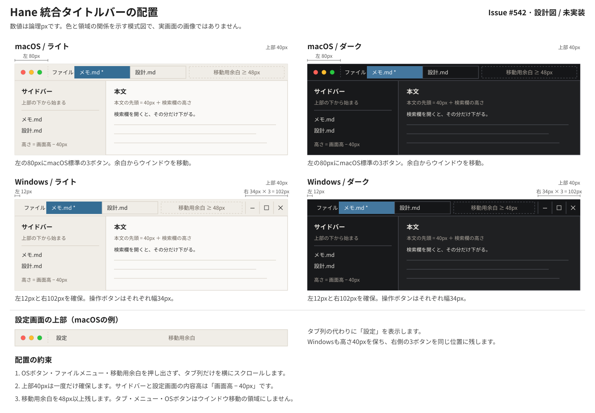

# タイトルバーとファイルタブの統合設計

仕事の契約・受入条件の正本: [Issue #542](https://github.com/hide212131/hane/issues/542)  
実装への引き継ぎ: [unified-titlebar-handoff.md](unified-titlebar-handoff.md)

## 1. 設計の位置づけ

Windows / macOSで、ウインドウ操作と既存のファイルタブを**高さ40pxの一段の上部**へまとめる。背景・タブ・操作ボタンをHaneのLight / Dark / System設定に合わせる。編集画面と設定画面は、同じ上部の下に配置する。

2026-10-21時点の実装前設計。製品コード、ビルド、実機での操作確認はこの文書の作成では変更・実施していない。現在の実装・受入状況はIssueと実装PRの証拠で確認する。設計PRの採用だけでは製品受入完了にならない。

基準mainは `29f7943ce225016ebf3f76c1115857d887388103`。依存は `gpui-pre = 0.3.6`、`gpui-pre-platform = 0.3.6`、`gpui-component = 0.6.6`。Haneのcrate名は `gpui` / `gpui_platform` / `gpui_component`。有効なOSパッチは `vendor/gpui-pre-macos` と `vendor/gpui-pre-windows` であり、古い `vendor/gpui` だけを根拠にAPIや実行経路を判断しない。[S1][S4]

既存の[ADR-0030](../adr/0030-gpui-kit-incremental-local-adoption.md)に従う局所的な部品導入とし、新しいADR、汎用レイアウト基盤、依存更新は必要としない。

## 2. 画面仕様



図は配置と配色の仕様を説明する模式図。OSボタンの実際の描画や、既存タブの細かなスタイルは実装部品に従う。

### 2.1 一段の上部

| 項目 | 決定 |
|---|---|
| 対象 | Windows / macOSのメインウインドウ |
| 高さ | `40.0`論理px。既存のタブ行を置き換える。別の40px行を追加しない |
| 左からの並び | macOS: 標準3ボタンの予約領域 → ファイルメニュー → タブ列 → 移動用余白。Windows: 左余白 → ファイルメニュー → タブ列 → 移動用余白 → 標準操作に接続する3ボタン |
| macOS左予約 | 部品既定の80px。標準3ボタンの位置は `(9, 12)` |
| Windows右予約 | 部品が描く3ボタン、幅34pxずつ、合計102px。高さは40pxに追従 |
| 移動用余白 | タブ列の右に最低48pxを常時確保。上部をつかめる場所をタブ数に依存させない |
| 狭幅 | メニュー・OSボタン・移動用余白は縮めない。残り幅をタブの表示領域にし、タブ列だけを横スクロール |
| 最小サイズ | 対象OSでは `window_min_size = 330 × 240`論理px。固定操作領域を保ちながらWindows Snapの小さい領域へ入れる範囲を広げる。初期サイズは現行960×760を維持 |
| 設定画面 | 同じ40px上部とOSボタンを保ち、メニュー・タブの代わりに「設定」を表示。既存の「アプリに戻る」は設定画面の本文側に残す |

Windows 11では最小幅がSnap領域より大きいと配置できない場合がある。Microsoftは幅330 effective pixels以下を、より広い端末でのSnap互換性の推奨値としている。Haneの下限は330論理pxを目標とし、表示倍率による実効寸法とSnap配置をT02/T04の実画面確認で記録する。

タイトルを重ねて表示するための行や、タブの追加・閉じるボタン、新しい検索欄は作らない。ウインドウ名の管理、既存キーボード操作、フォーカスの復帰経路は維持する。サイドバーは全幅の上部の下から始める。

### 2.2 配色

上部の背景には既存の `tab_bar_background`、文字には `tab_bar_foreground`、下端の1px境界には既存の `tab_bar_border` を使う。タブ選択・未選択・ホバーは現行の `TabBar` / `Tab` の配色を引き継ぐ。[S2]

| 部位 | Light | Dark |
|---|---|---|
| 上部背景 | `#f0ede7` | `#151618` |
| 本文背景 | `#faf9f7` | `#1f2022` |
| 本文文字 | `#262626` | `#e8e5df` |
| サイドバー背景 | `#f0ede7` | `#18191b` |

`TitleBar` の既定グラデーションは `.bg(...)` で単色に置き換える。現行の可視タブ行はすでにテーマ対応している。Lightでも暗い値を持つ未使用の `header_background` を、新しい上部背景として転用しない。[S2][S4]

### 2.3 並行作業との接続

| 対象 | 設計時点の事実 | 実装開始時の扱い |
|---|---|---|
| [PR #538](https://github.com/hide212131/hane/pull/538) / [#536](https://github.com/hide212131/hane/issues/536) | Open、head `beb51eca223d15f3ebec5b7a4a4367596c51f643`。`header_element` に `file_menu_button` を追加、テーマを一般設定へ移し、フッターを32pxにする | 上部の責務が直接重なる。先に採用されたcurrent mainを基準にメニュー・設定を引き継ぐ。未採用なら上部の担当範囲だけを調整してから実装に着手。未採用PR全体を複製しない |
| [PR #541](https://github.com/hide212131/hane/pull/541) / #306 | Open・Draft、head `9796d48ed7451e6b4af81028472b2857a5c01db3`。`BlockPresentationRequest` の整理 | 同じ `view.rs` でも確認時点では別責務。開始・統合前に差分を再確認し、これだけを理由に待たない |
| #304 / #491、#305 / #497 | 入力先整理と短い入力欄の共通経路は採用済み | 現行の入力・focus経路を利用する。#305全体のcloseを先行条件にしない |
| #297 / #307 | 全体リファクタリングと本文内部geometry整理 | 全体完了を待たない。文字配置・source対応・`BlockLayout` 内部の再設計は混ぜない |

この表は調査時点の記録であり、未マージ状態を恒久的な前提にしない。[機能開発の並行手順](../refactor-execution-plan.md#feature-development-policy)に従う。

## 3. 変更ファイルと責務

新しいファイル名は以下を予定する。既存コードの移動は上部構成に必要な範囲へ絞る。

| ファイル | 変更する責務 |
|---|---|
| `crates/ui/src/window_chrome.rs`（新規） | 共通高さ `WINDOW_TITLEBAR_HEIGHT`、対象OSのウインドウ生成オプション、native appearanceの設定と有効値取得を小さな関数にする |
| `crates/ui/src/lib.rs` | `window_chrome` とアプリから使う生成関数を公開 |
| `crates/app/src/main.rs` | 実ウインドウ生成で共通オプションを使う。既存の通常起動・instrument・終了フックを保つ |
| `crates/ui/src/view/titlebar.rs`（新規） | `TitleBar`、編集時の既存タブ列、設定時のラベル、操作とドラッグの境界を構成する。タブ内容・イベントは旧 `header_element` から必要な範囲だけ移す |
| `crates/ui/src/view.rs` | 共通外枠、初期化／設定変更時のテーマ同期、本文原点・高さ、サイドバーへ渡す高さ。`header_element` の配置と重複を整理 |
| `crates/ui/src/theme.rs` | `header_height` の40を共通定数から取得。既存フィールド名と配色を保つ |
| `crates/ui/src/view/viewport.rs`、`view/ai_selection.rs` | 本文原点を同じ意味で参照。値が同じなら不要な式変更を増やさない |
| `view/sidebar.rs`、`view/content_search.rs` | 高さ引数の意味を確認。相対位置は維持し、必要な場合だけコメント／呼出しを調整 |
| 上記に対応する既存テスト、必要なら `scripts/hosted_file_tabs_gui.py` | 実際の共通外枠を通る確認を追加・更新。#538採用済みのテーマ設定入口へ合わせる |

`capture.rs` / `input.rs`、入力ルーティング、document / session、保存処理、vendorは原則として読む対象。ここに修正が必要になった場合は、その理由が今回の上部変更から説明できるか再確認する。

## 4. ウインドウ生成とOS操作

### 4.1 生成設定

対象OSでは `gpui_component::TitleBar::window_options()` を基に、既存bounds、最小サイズ、macOSボタン位置を設定する。通常起動・instrument・新規の対象テストは同じ生成関数を通す。

```rust
// 設計上の形。実装はwindow_chrome側へ置く。
let mut options = WindowOptions {
    window_bounds: Some(WindowBounds::Windowed(bounds)),
    window_min_size: Some(size(px(330.0), px(240.0))),
    ..TitleBar::window_options()
};
#[cfg(target_os = "macos")]
if let Some(titlebar) = options.titlebar.as_mut() {
    titlebar.traffic_light_position = Some(point(px(9.0), px(12.0)));
}
```

`titlebar: Some(...)` と `app_owns_titlebar_drag: true` を保つ。`is_movable` / `is_resizable` / `is_minimizable` は既定のtrue。ウインドウ全体の透過設定は追加しない。[S4][S5]

macOSのy=12は、部品既定の高さ34・y=9に対して `(40 - 34) / 2` を加えた設計値。OS側は標準ボタンの実寸を読むため、全OSで厳密に同じ中心座標になるとは仮定しない。実画面で40px内への収まり・非重複・全画面復帰を確認する。修正が必要なら、まずこの一つの位置定数で調整できるか判断する。[S4][S6]

### 4.2 OS別の委譲

| 操作 | 利用する経路 |
|---|---|
| macOSの赤・黄・緑 | 既存のnativeボタン。Haneで描き直さない |
| macOS余白の二度押し | `TitleBar` → `window.titlebar_double_click()`。利用者のOS設定を尊重 |
| Windowsの最小化・最大化・閉じる | `TitleBar` の `WindowControlArea::Min / Max / Close` → backendの非クライアント操作 |
| Windows最大化ボタン上のSnap | `Max` → `HTMAXBUTTON` の既存経路を維持。実機で候補表示と配置を確認 |
| ウインドウ移動・上端／角のリサイズ | 部品と既存OS backendに任せ、同じ操作の追加ハンドラを重ねない |

Windowsの3ボタンへ独自の `on_click` を追加しない。backendが押下・解放から標準操作や `WM_CLOSE` へつなぐ。`TitleBar::on_close_window()` はLinux専用なので、Windows / macOSの終了フックに使わない。[S4][S7]

macOSの全画面往復は対象。全画面時の追加左余白と標準ボタンの復帰は既存部品・backendを利用する。基準HaneにWindows全画面の入口は確認できず、今回は新設しない。開始時のコードに入口が追加されていた場合だけ再評価する。現backendは全画面中に操作領域を返さず、部品は3ボタンを自動では隠さないため、動くと推測しない。

Linux等の非対象OSは既存の生成設定・標準タイトルバー・タブ行配置を維持する。対象OSの分岐を小さく置き、標準と独自のボタンを二重に出さない。Linuxの新規対応や実機合格は今回の成果に含めない。

## 5. 操作領域と移動用余白

`TitleBar 0.6.6` の内側全体には `WindowControlArea::Drag` が付く。タブやメニューを子に置くだけでは、OSのウインドウ移動と競合する。[S4]

メニューとタブのそれぞれを、次の条件を持つ操作領域で囲う。

1. `.occlude()` で親のDragを背後の当たり判定から除く。横スクロールするタブ列はこの囲いの内側に置く。
2. 左mousedownと二度押しの伝播をこの囲いで止め、親の `TitleBar` の移動開始・拡大処理へ流さない。子の既存クリック処理は先に実行される配置にする。
3. 最低48pxの移動用余白と、部品が描くWindows操作ボタンは囲いの外に置く。余白に別の移動・拡大ハンドラは足さない。

操作領域は `div().id("titlebar-tabs")` / `div().id("titlebar-menu")` のように安定したIDを付けて作る。0.6.6の `on_double_click` は `Stateful<E>` の拡張なので、IDなしの `Div` のまま呼ばない。形は以下のとおり。`gpui::InteractiveElement` と `gpui_component::InteractiveElementExt` を利用する。[S8]

```rust
div()
    .id("titlebar-tabs")
    .occlude()
    .on_mouse_down(MouseButton::Left, |_, _, cx| cx.stop_propagation())
    .on_double_click(|_, _, cx| cx.stop_propagation())
    .child(existing_tab_strip)
```

このGPUI版の `WindowControlArea` に `Client` / `NoDrag` はない。`.block_mouse_except_scroll()` は親Dragの当たり判定IDを消す代用にはならない。上部全体の `.occlude()` は移動用余白まで無効にするため使わない。mouseupの伝播まで一律に止めず、部品内部の `should_move` が解除される既存処理を残す。[S8]

タブ領域は `.flex_1().min_w_0().overflow_hidden()` とし、メニューと48px余白は `flex_none`。Windows右102pxは `TitleBar` 内部の固定領域に任せる。横スクロール対象にメニュー・余白・OSボタンを含めない。タブ表示領域内の空白も通常のタブ領域とし、移動は明示的に残した余白から行う。設定時は「設定」ラベルを除く空白を移動に使える。

ポップアップ・タブのメニューは既存の重なり順と遮蔽を使い、下のタイトルバーへ押下が抜けないことを確認する。モーダル表示中は既存の遮蔽規則を共通外枠にも適用し、背後のタブ・ファイルメニューを操作できる経路を増やさない。

## 6. 共通外枠と座標

### 6.1 編集画面・設定画面の構造

対象OSの共通rootは縦並びで「40pxの上部」「残りの内容」の二つにする。編集内容の中を従来どおりサイドバー・仕切り・main columnの横並びにする。main columnに旧headerを残さない。

設定画面は現在 `render` の途中で別rootを返すため、その分岐より前でテーマを同期し、両方を共通外枠へ渡す。設定画面の `request_leave_settings` と `settings_screen_shell` の `#[inline(never)]` は残す。後者はWindowsのUIスレッドのスタックを守るための分割であり、巨大な単一renderへ吸収しない。[S2]

内容側は `.flex_1().min_h(0).min_w(0)` などで残りの高さに収める。旧 `.size_full()` を40pxの下へそのまま積み、下端をはみ出させない。overlayがwindow座標を使う場合はouter rootに置くか座標系を明示し、移動した親の下で40pxを再加算しない。

### 6.2 不変条件

`H = window.viewport_size().height`、`T = 40`、`F = document_find_reserved_height()`、`B = self.theme.footer_height` とする。`B` は採用済みのテーマ値を使い、#538の32pxや基準mainの54pxを別の場所に固定しない。

| 領域 | ウインドウ内Y | 高さ |
|---|---|---|
| 上部 | `0` | `T` |
| 編集／設定の内容 | `T` | `max(0, H - T)` |
| サイドバー | `T` | `max(0, H - T)` |
| 本文 | `T + F` | `max(0, H - T - F - B)` |

本文左端は従来どおり、サイドバー表示時は `sidebar_width + SIDEBAR_RESIZER_WIDTH`、非表示時は0。文字のsource位置や折り返しの計算は変えない。

**本文は現行ですでにheaderの40pxを引いている。新しいタイトルバーと旧headerを二重に引かない。** 必要なら `editor_content_top()` のような小さな関数に `T + F` をまとめる。全体のgeometry基盤を追加する理由にはしない。

| 原点に依存するシンボル | 確認する意味 |
|---|---|
| `view.rs::render` | 本文の利用可能高 |
| `row_hit_at_window_point` | window座標から本文内の文字位置への変換 |
| `text_autoscroll_direction_for` | 範囲選択中の本文上端・下端 |
| `view/viewport.rs::on_scroll_at` / `on_pinch` | 拡大の基準となるポインター位置 |
| `view/ai_selection.rs::ai_selection_overlay_position` / `ai_selection_overlay` | 本文の選択位置とAI画面の上端制限 |

サイドバーへ渡す `sidebar_viewport_height` は `H - T` にする。`work_folder_sidebar` と `content_search_sidebar` は同じ意味の高さを受け取る。一方、`list_top` とスクロールバーの `.top(list_top)` はサイドバー内の相対位置なのでTを足さない。スクロールバーのドラッグ差分は既存のwindow座標差分を維持する。[S2][S3]

### 6.3 IMEの候補位置

`InputCapture` は本文先頭に残す。`ElementInputHandler` に渡す実描画boundsと、`bounds_for_range` が返すcaretの相対位置の組合せを維持する。フィルター・名前変更の短い入力欄も実boundsを使う。候補位置に40pxを手動加算しない。[S3]

サイドバーは親が40px下へ動くので、実IMEの候補位置は必ず実画面で確認する。貼り付けやcaret表示だけを候補位置確認の代わりにしない。

## 7. テーマ同期

アプリが描く色、部品のテーマ、macOS標準部品のappearanceを同じ設定から更新する。設定の保存・保存失敗の表示は現行経路を引き継ぐ。#538採用後は `set_theme(preference, window, cx)` を入口にし、旧footerの `cycle_theme` を復活させない。

### 7.1 設定とnative appearance

`cx.set_window_appearance(...)` は、current main（`d9050c1f02e06c8748399757f5131d29a0aea41a`）の現行GPUI公開APIには存在しない。実装PRで追加する新しい公開setterであり、既存APIとしては呼べない。以下は、そのsetterに渡す値の契約である。

| `ThemePreference` | 実装PRで追加する `cx.set_window_appearance(...)` の引数 |
|---|---|
| Light | `Some(WindowAppearance::Light)` |
| Dark | `Some(WindowAppearance::Dark)` |
| System | `None` |

Systemを、その瞬間のLight / Darkを入れた `Some(...)` に置き換えない。そうするとOS追従が固定される。Windowsではこのnative override APIはno-opであり、今回はHaneが描く上部と操作ボタンの配色を合わせる。OSが管理する外周1pxや影まで独自に変更するvendor拡張は追加しない。[S6][S7]

### 7.2 更新順と初期化

一時状態 `applied_theme_preference: Option<ThemePreference>` または同等の初回／設定変更判定を持つ。これは設定ファイルへ保存する新しい項目ではない。

1. 初回、またはpreference自体が変わったとき、native overrideを上表どおり設定する。同じ解決色でも、Systemから明示設定、明示設定からSystemへの変更を省略しない。
2. 有効なappearanceを読む小さな関数を使う。**macOSでは `cx.window_appearance()`、それ以外では既存の `window.appearance()`** を読む。
3. その値とpreferenceからHaneのthemeを解決する。初回／preference変更／解決色変更のいずれかで `sync_component_theme()` を一度実行し、上部を描画する前に揃える。判定用の状態は再通知前に更新する。
4. 文字色等のcacheを消す条件は実際の配色変更に対応させる。毎フレーム `Theme::change` を無条件に呼んで描画通知を繰り返さない。通常のrenderも手順2と同じ取得関数を使う。

`Window::appearance()` はキャッシュで、macOSの変更通知による更新は非同期に実行される。override解除直後にこのキャッシュを読むと、古い明暗で描画し直す可能性がある。`cx.window_appearance()` は `NSApplication.effectiveAppearance` を直接読むため、設定直後にもrenderにも同じ取得関数を使う。固定時間の待機や任意のdefer順には頼らない。[S6][S8]

`ComponentTheme::change()` だけではmacOS標準部品のappearanceは変わらない。初期Hane themeと保存設定がともにLightで見かけの色変化がなくても、初回同期を一度行う。設定画面の早期returnより前に処理し、設定中の上部にも即時反映する。[S2][S4]

## 8. 既存操作を保つ境界

### 8.1 ファイルメニューとタブ

採用済みの `file_menu_button` は既存のopen／unsaved guardとIME中の制約をそのまま使う。メニューボタンを本文のmousedown処理へ巻き込み、本文選択を消さない。

| 操作・状態 | 保持する経路 |
|---|---|
| 左クリック | `TabBar::on_click` → indexから `SessionId` → `activate_file_tab` → `activate_session` |
| 右クリック | 描画時の `SessionId` → `open_file_tab_context_menu`。背景タブを勝手にアクティブにしない |
| 中クリック | mousedownで一度だけ `request_tab_close`。mouseupに重複登録しない |
| ホイール | 既存 `file_tabs_scroll`、縦wheelから横scrollへの変換、範囲制限、本文への伝播停止 |
| 末尾タブの表示 | `reveal_file_tab` / `scroll_to_item` を維持 |
| パス表示・未保存表示 | `HoverCard` の識別子は `SessionId`。表示indexへ変えない。既存の `*` とパスコピーを維持 |

`Ctrl+Tab`、IME中の切替制約、名前変更の完了／取消、focusの復帰は現行経路を使う。新しい上部専用の入力ルーティングは作らない。[S2]

### 8.2 ウインドウを閉じる／タブを閉じる

ウインドウの閉じるボタンは、既存のOS終了経路を一度だけ通す。通常ビルドの `main.rs::on_window_should_close` は `flush_pending_drafts(); true`。終了フックを通らない直接破棄や、`close_tab_now` への置換はしない。[S1]

基準mainに全タブの未保存確認はなく、今回新設しない。`flush_pending_drafts` は作業フォルダーに属する無題の下書きを書き出すもので、全ファイルの未保存編集を保存する保証ではない。アプリ終了時の既存hookも保つ。

タブの中クリックは既存の保存／破棄／キャンセル、文書世代、保存失敗時の保持をそのまま通す。ウインドウ終了とタブ終了を共通の新しい保存機構へまとめない。終了フックは基準mainで非instrument時の設定なので、下書き復元は通常ビルドでも確認する。[S1][S2]

## 9. 実装順

1. current mainと#538の受入状態を読み、設計を実装branchから読めるようにする。#538との上部責務を確定してから製品変更を始める。
2. 共通定数とウインドウ生成関数を追加し、対象OSだけを接続する。同時に共通外枠・設定画面・既存タブの配置を一つの変更として整える。
3. 操作領域の遮蔽、48px余白、狭幅、テーマ同期とnative appearanceの取得を接続する。サイドバー高と本文原点の参照を確認する。
4. 既存テストを維持し、実際の共通外枠の位置・テーマ遷移・狭幅／操作境界に関係する回帰確認を加える。安定した候補で既存CIと必要な実画面確認を行う。
5. current headと必要なbase contextの証拠を実装PRへまとめ、Issueの受入条件と対応させる。実行できない項目は未確認として残す。

詳細な実行権限・workerへの渡し方は[引き継ぎ文書](unified-titlebar-handoff.md)と既存の[Claude実行手順](../aadw-claude-execution.md)に従う。

## 10. 確認計画

### 10.1 対象となる確認

| ID | 操作と合格条件 | 方法 |
|---|---|---|
| T01 配色 | 両OSでOS Light / Dark × アプリ Light / Dark / Systemの6通り。初回起動、再起動、同じ解決色の明示設定→System、System中のOS変更、明示設定中のOS変更、設定画面でも一貫 | theme／状態遷移の対象テスト＋両OS画面 |
| T02 幅 | 330 / 360 / 480 / 960px、サイドバー有無、多数タブ、長い日本語名。メニュー・右102px・移動余白が押し出されず末尾タブへ到達。最小高さで内容が重ならず必要なscrollが可能 | 実rootのboundsテスト＋両OS画面 |
| T03 操作境界 | 余白だけで移動。タブ／メニューのクリック・二度押しで移動や拡大を起こさない。ポップアップの下へ操作が漏れない | 対象テスト＋両OS直接操作 |
| T04 OS操作 | 最小化・復帰、最大化・復帰、上端・各角のresize。Windows Snap候補と配置、macOS標準3ボタン・二度押し設定・全画面往復 | 両OS直接操作。Windowsは100%と別の表示倍率、macOSは二度押しのOS設定も記録 |
| T05 タブ | 左／右／中クリック、横scroll、Ctrl+Tab、dirtyタブの取消・保存・保存失敗。対象SessionIdと表示追従を維持 | 既存タブテスト＋代表操作 |
| T06 座標 | 先頭・折返し行のクリックと選択、検索欄開閉、sidebar幅変更、wheel／pinch拡大、選択自動scroll、AI選択画面が実描画と一致 | 既存geometryテスト＋実rootの位置確認・短い実編集 |
| T07 日本語 | 本文・filter・renameで実IMEの未確定／確定／取消とfocus切替。入力先が漏れず、候補位置を新たにずらさない | 両OS実IME。必要な状態を変更前と比較 |
| T08 画面遷移 | 設定／検索／AI／確認画面で上部操作を失わず、モーダルの背後へ操作が漏れない。戻ると選択・scroll位置が保たれる | 既存focus／overlayテスト＋代表画面 |
| T09 終了 | 通常ビルドで無題下書きへ入力し、新しい閉じるボタンで終了、再起動で復元。終了フックを通る | 両OS・隔離state、ファイル内容と復元結果 |
| T10 品質・性能 | current headの既存workspace tests／Clippy、両OS required CI、通常・release build。ADR-0030に沿う初期表示・入力・大文書／scroll・タブ操作の必要な比較 | 既存の計測・基準を再利用。新しい測定基盤や閾値は作らない |

### 10.2 再利用するテスト

`crates/ui/src/view.rs` の関係する既存テストを維持する。関数が分割されても名前と意図で追う。

| 関係 | 既存テスト名 |
|---|---|
| 色・タブ到達 | `active_file_tab_foreground_is_readable_in_both_themes`、`file_tabs_switch_sessions_and_keep_rear_tabs_reachable` |
| 長いパス・右クリック | `a_long_path_file_tab_keeps_its_trigger_within_its_own_tab_bounds_in_a_narrow_window`、`right_clicking_a_file_tab_targets_that_session_without_activating_it` |
| 中クリック・未保存 | `middle_click_closes_a_clean_non_active_tab_without_switching_active_session`、`middle_click_on_dirty_tab_prompts_and_cancel_leaves_it_open`、`middle_click_dirty_tab_save_and_close_writes_then_closes`、`middle_click_dirty_tab_save_and_close_failure_leaves_it_open` |
| sidebar・検索欄 | `sidebar_scrolls_rows_without_moving_fixed_controls`、`opening_the_find_bar_pushes_rows_down_and_shrinks_the_viewport_by_its_reserved_height`、`click_hit_testing_matches_the_shifted_row_position_while_the_find_bar_is_open`、`caret_and_scrollbar_geometry_match_the_shrunken_viewport_while_the_find_bar_is_open` |
| 入力・拡大・自動scroll | `drag_selection_from_row_start_lands_on_the_clicked_character_with_sidebar_open`、`ctrl_wheel_zooms_while_plain_wheel_only_scrolls`、`drag_selection_autoscrolls_down_while_held_near_the_bottom_edge_and_stops_on_mouse_up` |
| IME・下書き | `text_input_bounds_report_origin_moves_for_ime_position_refresh`、`ctrl_tab_does_not_switch_tabs_during_ime_composition`、`flush_pending_drafts_writes_immediately_without_waiting_for_the_debounce` |

`theme.rs::resolves_dark_matches_resolve_theme_choice_for_every_combination` と、`view/ai_selection.rs` の `overlay_position_sits_just_below_the_selection_when_the_editor_area_has_room` / `overlay_position_flips_to_sit_just_above_the_selection_when_below_would_clip` も関係する。

既存のテスト用ウインドウが既定の `WindowOptions` で起動する場合、その成功だけでは新しい生成設定を検証できない。今回の対象テストはHaneの共通生成関数を通す小さなhelperを使う。全テストのためにvendorの既定値を変えない。定数同士の一致だけのテストより、実rootの描画bounds、イベントの対象、設定遷移を確認する。

### 10.3 実画面の記録と既知の問題

手順の正本は[local-gui-validation.md](../local-gui-validation.md)と[gui-test-recovery.md](../gui-test-recovery.md)。記録はcurrent head、必要なbase context、OS・表示倍率、ビルド元／実行パス／PID、隔離 `HANE_STATE_DIR`、fixture、操作、画像、観測結果を結び付ける。

Windowsは `papa-win` に接続したWindows側ChatGPTから直接操作する。MacからVM画面を操作する経路へ変えない。ARM64環境でx64アプリを確認した場合は条件を明記する。ショートカット試験中はKeyhacのhookをOFFにし、利用者指定どおり終了時にONへ戻す。確認用の余分なプロセスを終了する。

`scripts/hosted_file_tabs_gui.py` の基準版は旧footerのTheme表示を探す。#538の変更を確認し、採用後の一般設定へ合わせる。この手順の成功だけでOSボタン・Snap・全画面を合格にしない。

[#523](https://github.com/hide212131/hane/issues/523)はWindowsの変換中filter再クリック後の候補位置の既知Issue。今回の候補位置確認を省略せず、同条件のbaselineと比較して既存問題／新しいずれ／未確認を分ける。[#524](https://github.com/hide212131/hane/issues/524)のrename待ち中の入力漏れは、今回の差分が入力待ち・routingへ及ぶ場合に遅延条件の確認を追加する。既知Issue番号だけを根拠に今回の不具合を除外しない。

## 11. 実装時に判断を戻す条件

基本構成・部品・寸法・処理順はこの設計で決定する。次の観測が出た場合は、原因と影響する範囲をIssue／設計へ反映してから変更する。

- current mainの依存や#538の採用結果が変わり、既存メニュー・theme入口と本設計が両立しない。
- `.occlude()` と既存イベント経路で操作とウインドウ移動を分けられない、またはOSのSnap／終了経路を保てない。
- 標準ボタンが40pxに収まらない、最小サイズで固定操作領域が重なる、native appearanceの通知が想定と異なる。
- 今回の画面原点変更だけでは説明できない入力漏れ・保存・文字配置の修正が必要になる。

これらを先回りしてvendorのfork、独自OSボタン、別の入力経路、全体レイアウト刷新を作る理由にはしない。受入に必要な実画面がない場合は未確認の条件を明記し、コード調査を実機合格へ読み替えない。

## 12. 根拠

固定版のソースを設計根拠とする。実装開始時はcurrent mainとの差分を確認する。

- **[S1] Hane生成入口と依存**: [main.rs](https://github.com/hide212131/hane/blob/29f7943ce225016ebf3f76c1115857d887388103/crates/app/src/main.rs)、[Cargo.toml](https://github.com/hide212131/hane/blob/29f7943ce225016ebf3f76c1115857d887388103/Cargo.toml)。
- **[S2] 画面・タブ・設定・配色**: [view.rs](https://github.com/hide212131/hane/blob/29f7943ce225016ebf3f76c1115857d887388103/crates/ui/src/view.rs)、[theme.rs](https://github.com/hide212131/hane/blob/29f7943ce225016ebf3f76c1115857d887388103/crates/ui/src/theme.rs)。
- **[S3] 座標と入力候補**: [sidebar.rs](https://github.com/hide212131/hane/blob/29f7943ce225016ebf3f76c1115857d887388103/crates/ui/src/view/sidebar.rs)、[content_search.rs](https://github.com/hide212131/hane/blob/29f7943ce225016ebf3f76c1115857d887388103/crates/ui/src/view/content_search.rs)、[viewport.rs](https://github.com/hide212131/hane/blob/29f7943ce225016ebf3f76c1115857d887388103/crates/ui/src/view/viewport.rs)、[ai_selection.rs](https://github.com/hide212131/hane/blob/29f7943ce225016ebf3f76c1115857d887388103/crates/ui/src/view/ai_selection.rs)、[capture.rs](https://github.com/hide212131/hane/blob/29f7943ce225016ebf3f76c1115857d887388103/crates/ui/src/capture.rs)、[input.rs](https://github.com/hide212131/hane/blob/29f7943ce225016ebf3f76c1115857d887388103/crates/ui/src/input.rs)。
- **[S4] gpui-component 0.6.6**: [title_bar.rs](https://github.com/longbridge/gpui-kit/blob/v0.6.6/crates/component/src/title_bar.rs)、[theme/mod.rs](https://github.com/longbridge/gpui-kit/blob/v0.6.6/crates/component/src/theme/mod.rs)、[固定版TitleBar文書](https://gpui-kit.com/versions/v0.6.6/component/title-bar)。公開文書のcrate名表記をHaneの依存名へそのまま置き換えず、`gpui_component` を使う。
- **[S5] GPUI 0.3.6の元commit**: [platform.rsのWindowOptions](https://github.com/zed-industries/zed/blob/bcf6582ce3500df93a8a39366640173e6786cea6/crates/gpui/src/platform.rs)。
- **[S6] HaneのmacOS backend**: [window.rs](https://github.com/hide212131/hane/blob/29f7943ce225016ebf3f76c1115857d887388103/vendor/gpui-pre-macos/src/window.rs)、[platform.rs](https://github.com/hide212131/hane/blob/29f7943ce225016ebf3f76c1115857d887388103/vendor/gpui-pre-macos/src/platform.rs)。
- **[S7] HaneのWindows backend**: [events.rs](https://github.com/hide212131/hane/blob/29f7943ce225016ebf3f76c1115857d887388103/vendor/gpui-pre-windows/src/events.rs)、[util.rs](https://github.com/hide212131/hane/blob/29f7943ce225016ebf3f76c1115857d887388103/vendor/gpui-pre-windows/src/util.rs)。SnapのOS契約: [Microsoft公式](https://learn.microsoft.com/en-us/windows/apps/desktop/modernize/ui/apply-snap-layout-menu)。
- **[S8] 当たり判定・appearance・style**: 固定GPUIの [window.rs](https://github.com/zed-industries/zed/blob/bcf6582ce3500df93a8a39366640173e6786cea6/crates/gpui/src/window.rs)、[app.rs](https://github.com/zed-industries/zed/blob/bcf6582ce3500df93a8a39366640173e6786cea6/crates/gpui/src/app.rs)、[elements/div.rs](https://github.com/zed-industries/zed/blob/bcf6582ce3500df93a8a39366640173e6786cea6/crates/gpui/src/elements/div.rs)、[styled.rs](https://github.com/zed-industries/zed/blob/bcf6582ce3500df93a8a39366640173e6786cea6/crates/gpui/src/styled.rs)、部品側の [base/src/event.rs](https://github.com/longbridge/gpui-kit/blob/v0.6.6/crates/base/src/event.rs)。
