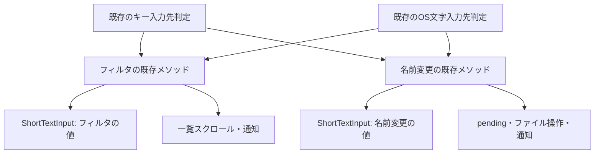

# RF3-B: フィルタ・名前変更の短い入力欄を共通化する実装仕様

対象: [Issue #305](https://github.com/hide212131/hane/issues/305) / 親 [#297](https://github.com/hide212131/hane/issues/297)

設計日: 2026-10-17（日本時間）

読解基準: `2164b895e849eef4de8c80c3696c0fd8e00c496b`（以下「基準main」）

位置付け: 実装前の詳細設計。製品コードの変更、Rustテスト、実OSの画面確認は、この文書を作成する工程では実施していない。

## 1. 実装することと着手条件

フィルタと名前変更欄がそれぞれ持つ、文字列・選択範囲と向き・変換中の範囲・取り消し用の保存状態を、一つの具体的な型 `ShortTextInput` へまとめる。型の実装は一つにし、フィルタ用と名前変更用には別々の値を置く。両方の欄で一つの可変文字列を共有する設計ではない。

文字列と範囲を変更するコードはこの型の内部へ移す。各欄の既存メソッドは、入力を受け付ける条件を確認し、共通操作を呼び、従来の通知や一覧更新を行う。本文Editor、入力先を選ぶ処理、名前変更のファイル操作をこの型へ移さない。

### 1.1 前提の現在地

| 前提 | 2026-10-17に確認した事実 | #305での扱い |
| --- | --- | --- |
| #301のfilter分離 | [#388](https://github.com/hide212131/hane/pull/388) がmerge済み。`view/sidebar_filter.rs` が存在する | この境界を使う |
| #301のrename分離 | [#396](https://github.com/hide212131/hane/pull/396) がmerge済み。`view/inline_rename.rs` が存在する | この境界を使う |
| #301全体 | closed / not_planned。全UI分割の完了ではない | 全体の再開を先行条件にしない。残件を完了扱いにもしない |
| #304の入力先整理 | [#477](https://github.com/hide212131/hane/pull/477)、[#488](https://github.com/hide212131/hane/pull/488)、[#491](https://github.com/hide212131/hane/pull/491) がmerge済み。Issueはcompleted | `view/input_routing.rs` の現在の入口ごとの優先順を維持する |
| #491の最終修正 | 製品コード `0a9bc16ae2bdef04ec0dbe2f4f72ecad0af61aa7`、最終PR head `ae44b00ec72c9caa478155b03eaa462b2edb0632`、merge `84d633b440c095d284dc9615c380fe9e06879ec4` | 日本語入力の取消と、rename処理待ち後の遅延入力保護を引き継ぐ |

根拠は [#304の完了記録](https://github.com/hide212131/hane/issues/304)、[#301の整理記録](https://github.com/hide212131/hane/issues/301#issuecomment-6096695508)、[共通実行計画](refactor-execution-plan.md) の9.9節・9.11節にある。以前の設計書に残る「未実装」は、その文書の作成時点の記録として読む。

実装開始時にcurrent mainとopen PRを取り直す。基準mainからの差分のうち、本書の対象ファイル・入力経路・検証条件へ影響する変更だけを確認する。無関係な機能追加を待たせず、古いbranchからfilter/renameや入力callbackの実装を上書きしない。

設計保存時に、本文のOS別編集キーを整備する [#494](https://github.com/hide212131/hane/issues/494) / [#495](https://github.com/hide212131/hane/pull/495) も進行している。#495のhead `e5c61881f44f650a6b5ff9a68d324b52bfbcd213` では準備文書だけで、製品変更はまだ差分にないことを確認した。この作業は `actions.rs`、`view.rs`、入力接続テストと重なる可能性がある。本書のHome/End等の操作表は基準mainのactionの意味を記録しており、将来の実キー割当を固定するものではない。#495が先に受け入れられたら、そのOS別割当と入力抑止を維持して本書の呼出元・試験手順を読み替え、旧割当へ戻さない。追加の本文専用操作を短い入力欄モデルへ取り込む必要もない。

### 1.2 今回決める範囲

共通化するのは、既存の文字編集操作と、それに伴う範囲・変換状態の整合した更新である。検索機能の追加、名前の検証規則の変更、ショートカットの追加、Undo/Redoの導入は含めない。本文Editorを短い入力欄へ組み込まず、汎用trait、イベントバス、新しいcrate、別のGPUI Entityも追加しない。

本書は既存方針に沿う局所設計であり、新しいADRは作らない。[RF3の計画](refactor-plan.md#rf3--入力先の決定と編集処理を整理する) と [Commander Policy](aadw-command-policy.md) を参照する。実装・レビュー・mergeの役割分担は、その時点の同Policyを正本とする。

## 2. 現在の責務と変更後の責務

ここでいう「変換中の状態」は、日本語などを入力し、まだ確定していない文字列とその取消に必要な情報を指す。OSの入力方式（Input Method Editor、IME）からの通知を解釈する処理と、その通知に応じて文字列を更新する処理を分けて扱う。

| 現在の所有者・処理 | 現在の内容 | 変更後 |
| --- | --- | --- |
| `EditorView` のfilter用5フィールド | `sidebar_filter`、`sidebar_filter_selected_range`、`sidebar_filter_selection_reversed`、`sidebar_filter_marked_range`、`sidebar_filter_composition` | `sidebar_filter: ShortTextInput` 一つへ置換 |
| `InlineRename` の文字編集用5フィールド | `text`、`selected_range`、`selection_reversed`、`marked_range`、`composition` | `input: ShortTextInput` 一つへ置換 |
| `SidebarFilterComposition` / `InlineRenameComposition` | 変換開始前の文字列・選択範囲・向き | 新module内の非公開 `CompositionSnapshot` 一つへ統合 |
| `view.rs` のUTF-16変換・文字境界・選択helper | 両方の欄から利用するが、名前と配置はrenameに寄っている | `short_text_input.rs` 内へ移動し、範囲更新は型の非公開処理にする |
| `view/sidebar_filter.rs` | raw focus確認、文字編集、一覧スクロール、通知 | 条件確認・共通操作の呼出し・一覧更新・通知を残す |
| `view/inline_rename.rs` | pending確認、文字編集、名前変更の開始・確定・取消・完了 | 条件確認・共通操作の呼出し・ファイル操作・通知を残す |
| `input.rs` / `view/input_routing.rs` | OS通知の取消判定、入力先、遅延入力保護、本文への接続 | 判定・順序・本文処理を維持する |
| `InlineRenameRenderState` / `InlineRenameInput` | 文字列と範囲の描画用コピー、位置計算、入力handler登録 | 名前と描画処理を維持し、新モデルの読み取り値から従来どおり作る |

`InlineRenameRenderState` は一時的な描画用コピーであり、編集状態の正本にはしない。そこからモデルへ文字列や範囲を書き戻す経路を作らない。取り消し用の `CompositionSnapshot` も、確定前の状態を復元するためだけにモデル内に置く。



上図は短い入力欄の経路だけを示す。本文への分岐は既存Editorへ続く。キーとOS通知の入力先判定は同一関数ではなく、第6節の差を保つ。

## 3. 型、配置、公開範囲

新設先は `crates/ui/src/short_text_input.rs` とし、`crates/ui/src/lib.rs` に非公開の `mod short_text_input;` を追加する。GPUI、session、ファイルサービスには依存せず、`std::ops::Range` と既存の `unicode-segmentation` だけを使う。Cargo設定・lockを変える必要はない。

```rust
pub(crate) struct ShortTextInput {
    text: String,
    selected_range: Range<usize>,
    selection_reversed: bool,
    marked_range: Option<Range<usize>>,
    composition: Option<CompositionSnapshot>,
}

struct CompositionSnapshot {
    text: String,
    selected_range: Range<usize>,
    selection_reversed: bool,
}
```

状態フィールドはすべてmodule外から書き換えられないようにする。`text_mut`、`selection_mut`、可変参照を返すgetter、`DerefMut`、任意のbyte範囲を直接設定するAPIは設けない。`view` の子moduleに置くよりも、兄弟moduleに置くことで、既存のView側からもこの境界を守りやすくする。

`InlineRename` には `kind`、`from`、`fixed_extension`、`pending` と `input` が残る。filterの `sidebar_filter_focused`、`sidebar_filter_input_bounds`、`sidebar_keyboard_focus` は `EditorView` に残す。`inline_rename_swallowed_input` の所有者・寿命も変更しない。

### 3.1 読み取りAPI

以下は実装時の関数契約である。範囲を返すgetterはコピーを返し、モデルの可変参照を返さない。

| 署名（すべて `pub(crate)`） | 契約 |
| --- | --- |
| `new(text: String) -> Self` | 文字列を無加工で受け取り、末尾に空選択を置く。向きはfalse、変換状態なし |
| `Default::default() -> Self` | 空文字列、`0..0`、向きfalse、変換状態なし |
| `text(&self) -> &str` | 現在の文字列。filter条件とrename確定時にもここから読む |
| `selected_range(&self) -> Range<usize>` | 現在のUTF-8 byte範囲 |
| `selection_reversed(&self) -> bool` | 選択の動く端がstart側ならtrue |
| `marked_range(&self) -> Option<Range<usize>>` | 描画用のUTF-8 byte範囲 |
| `has_composition(&self) -> bool` | 取消用の保存状態があるか。markedの有無から推測しない |
| `selected_text(&self) -> Option<&str>` | 非空選択だけを借用して返す。clipboardへ渡す所有文字列は既存メソッドで作る |
| `text_for_utf16_range(&self, range: Range<usize>) -> (String, Range<usize>)` | 実際に切り出した文字列と、丸め後のUTF-16範囲を返す |
| `selection_utf16(&self) -> (Range<usize>, bool)` | 範囲をUTF-16へ変換し、向きをそのまま返す |
| `marked_range_utf16(&self) -> Option<Range<usize>>` | markedだけをUTF-16へ変換する |

### 3.2 更新API

| 署名（すべて `pub(crate)`） | 契約 |
| --- | --- |
| `replace(&mut self, range_utf16: Option<Range<usize>>, text: &str)` | 第5.1節の範囲優先順で置換し、選択と変換状態をまとめて更新 |
| `replace_and_mark(&mut self, range_utf16: Option<Range<usize>>, text: &str, selected_utf16: Option<Range<usize>>)` | 第5.2節の順に変換開始前の状態を保存し、置換・marked・選択を更新 |
| `move_horizontal(&mut self, right: bool, extend: bool)` | 現在の左右移動と選択拡張を一つにする。既存の境界計算を使う |
| `move_home(&mut self, extend: bool)` / `move_end(&mut self, extend: bool)` | 先頭・末尾へ移動。extend=trueでは固定端を保つ |
| `select_all(&mut self)` | `0..text.len()`、向きfalse。変換状態は変えない |
| `set_caret_utf16(&mut self, offset: usize)` | マウス位置を変換したUTF-16位置に空選択を置く。向きfalse。変換状態は変えない |
| `delete(&mut self, backwards: bool)` | 選択、または隣接する文字の範囲を削除し、選択と変換状態を更新 |
| `commit_composition(&mut self) -> bool` | 保存状態がある場合だけ取り除き、markedを消してtrueを返す。文字列・選択は維持 |
| `cancel_composition(&mut self) -> bool` | 保存状態があれば文字列・範囲・向きを復元し、markedを消してtrueを返す |
| `discard_composition(&mut self)` | 文字列・選択を維持してmarkedと保存状態を消す。filterのblurに用いる |

`replace`、`delete`、移動・選択の結果を「文字が変わったか」というboolにしない。端での削除など、文字列が変わらなくても既存の副作用を行う操作がある。commit/cancelだけは、従来と同じ「保存状態があったか」で呼出元の通知を分ける。

`new` は改行を除去しない。現在のrename開始処理は、UTF-8で表せるファイル名を無加工で取り込む。単一行としてのCR/LF除去は、現在と同じく `replace` / `replace_and_mark` の入力文字列にだけ適用する。

### 3.3 共通helperの移動

| 現在の `view.rs` のシンボル | 新module内の扱い |
| --- | --- |
| `byte_offset_from_utf16` / `byte_range_from_utf16` / `range_to_utf16` | 非公開の純粋関数。既存の端点変換を維持 |
| `utf16_offset_from_byte` | 読み取り専用の `pub(crate)` 関数を一つだけ置く。モデル内部と、両欄の描画位置からの変換で共用 |
| `inline_rename_selected_range` | 非公開 `selected_range_in_replacement` へ移動。置換文字列を基準にした選択位置を求める |
| `previous_inline_rename_boundary` / `next_inline_rename_boundary` | 非公開 `previous_boundary` / `next_boundary` へ移動 |
| `inline_rename_cursor` | `ShortTextInput::cursor` へ移動、非公開 |
| `select_inline_rename_to` / `select_inline_rename_to_fields` | 非公開 `ShortTextInput::select_to` 一つへ置換 |

描画位置の変換では、必ずその描画に使った `state.text` を `utf16_offset_from_byte` へ渡す。とくにfilter側は `text_input_render_state()` を使用しているので、共通化を理由に別のモデルの文字列へ読み替えない。共通関数の実装は一つにし、Viewには旧関数の転送用定義も残さない。

`crates/ui/src/ranges.rs` は描画・整形用の範囲分割を担い、文字列の妥当性は検査しない。今回の変換・編集helperはそこへ移さない。`shape_inline_rename_line` など描画名の改名も、この移行に必要ない。

## 4. 文字位置と常に守る条件

内部はRustの文字列を安全に切り出せるbyte位置で範囲を持つ。OSへ渡す位置は16bit単位で数える文字位置である。これをUTF-16位置と呼ぶ。見た目上まとまった一文字、たとえば基底文字と結合アクセントを左右移動で扱う単位は、書記素クラスタ（grapheme cluster）と呼ぶ。

この三つを混同しない。内部範囲のすべてを見た目上の文字境界へ寄せる変更は行わない。OS由来の選択は、結合文字列の途中のUnicode scalar境界を指すことがある。

| 項目 | 守る条件 |
| --- | --- |
| 内部selection / marked | `0 <= start <= end <= text.len()`。両端はUTF-8のscalar境界 |
| selectionの向き | `selection_reversed` を独立に保持する。空範囲だから常にfalseへ正規化する、という変更はしない |
| 変換開始前の状態 | 保存した文字列に対して、その保存selectionが有効。変換が更新されても最初の保存を上書きしない |
| markedと保存状態 | 空のmark更新では `marked=None` かつ `composition=Some` があり得る。同値条件にしない |
| 外部からの範囲 | `range_utf16` と `selected_utf16` の両方で `start <= end` を前提とする。上限超過は従来どおり末尾へ丸める |
| UTF-16の2単位文字の途中 | 現行helperどおり、その文字の後ろのscalar境界へ切り上げる。前へ丸めたり、選択範囲を文字全体へ広げたりしない |
| 通常の左右移動・削除 | 既存の `text[..offset]` / `text[offset..]` と `grapheme_indices(true)` の計算を維持する |
| モデル外の状態 | focus、pending、bounds、clipboard、ファイル状態はモデルの不変条件に含めず、既存の所有者が管理する |

範囲が逆転した入力は、現在のhelperでも保証されていない。本Issueで端点を並べ替えたり、エラー型を導入したり、黙って無視する仕様へ変更しない。上表の保証は順序付き範囲という前提を満たす入力に対するものである。実OSや既存の呼出元から逆転範囲が観測された場合は、その事実を記録し、受入を妨げるかを判断したうえで修正を分ける。根拠なく安全な入力だったと扱わない。

### 4.1 固定するUnicodeの例

既存の#304テストと同じ `A😀e\u{301}Z` を使う。表示上は `A😀éZ` で、UTF-8は9 bytes、UTF-16は6単位になる。

| UTF-16位置 | 現行変換で得るbyte位置 | 意味 |
| --- | --- | --- |
| 0 / 1 | 0 / 1 | 先頭 / 絵文字の直前 |
| 2 / 3 | 5 / 5 | 2は絵文字の途中なので、その後ろへ切り上げる |
| 4 / 5 / 6 | 6 / 8 / 9 | 結合アクセントの直前 / Zの直前 / 末尾 |
| 99 | 9 | 上限を越えた位置は末尾 |

したがってUTF-16 `1..3` の読出しは `😀` と実範囲 `1..3` を返し、`2..3` は空文字列と実範囲 `3..3` を返す。この規則を期待値として直接記述し、新helperから期待値を算出しない。

## 5. 共通操作の具体的な処理順

### 5.1 確定文字列の置換

`replace` は次の順で処理する。呼出前の入力先判断、raw focus確認、rename pending確認は既存メソッドに残す。

1. 明示されたUTF-16範囲、現在のmarked範囲、現在のselectionの順で、最初に存在する範囲を選ぶ。明示範囲は空範囲でも優先する。
2. 受け取った文字列から `\r` と `\n` だけを除く。タブ、空白、Unicode正規化などの規則は加えない。
3. 選んだ範囲を置き換え、`range.start + replacement.len()` に空選択を置く。向きをfalseにし、markedと保存状態を消す。
4. 呼出元が従来どおりfilterの一覧更新、またはrenameの通知を行う。文字列が同じになった場合も省略しない。

### 5.2 変換中の文字列の置換

`replace_and_mark` は、保存状態がまだなければ更新前の文字列・selection・向きを一度だけ保存する。その後は5.1節と同じ優先順とCR/LF除去で置き換える。

markedは置換部分のbyte範囲とし、CR/LF除去後の置換部分 `replacement` が空ならNoneにする。欄全体の文字列が空かどうかでは判定しない。`selected_utf16` があれば、**CR/LF除去後の置換文字列の先頭を0とする相対位置**として端点を変換し、挿入開始位置を足す。なければmarkedの有無によらず `range.start + replacement.len()` に空選択を置く。向きはfalseにする。削除した改行に合わせて選択位置を再マッピングする変更は行わず、現行の置換後文字列に対する丸めを維持する。

保存状態が存在する間は、次のmark更新でそれを上書きしない。空の更新でも、モデル自体は「OSが取消を要求した」と判断しない。OS通知の取消判定は `input.rs` がモデルを呼ぶ前に行う。

### 5.3 確定・取消・blur

| 操作 | モデル内の結果 | 呼出元の結果 |
| --- | --- | --- |
| 変換を確定する | 保存状態があれば破棄し、markedを消す。現在の文字列とselectionを維持 | trueの場合だけ従来のnotify。filterのスクロールは戻さない |
| 変換を取り消す | 保存した文字列・selection・向きを復元し、markedと保存状態を消す | trueの場合、filterは一覧スクロールを戻してnotify、renameはnotify |
| filterをblurする | raw focusがtrueのときだけ `discard_composition` で現在の文字列とselectionを保ち、markedと保存状態を消す | 同じ条件の内側でraw focus / sidebar keyboard focusをfalseにし、従来のnotify。raw focus=falseなら何もしない |
| rename全体を取り消す | `InlineRename` ごと破棄する | pendingなら既存どおり拒否。保存待ち再開等の既存処理を維持 |

blurをcancelへ置き換えると、現在見えているfilter文字列が変換前へ戻ってしまうため行わない。`commit_composition` と `discard_composition` も同じ通知条件の操作ではない。

### 5.4 選択・移動・削除

左右移動でextend=falseかつ非空selectionなら、右はend、左はstartへ畳む。それ以上一文字進めない。空selectionからの移動は既存の文字境界計算を使う。extend=trueなら固定端を維持し、動く端が固定端を越えたときだけ端点を入れ替えて向きを反転する。

たとえば `ab` の `0..1` を逆向きに選択しているとき、右へ一回拡張すると `1..1`、向きtrueになる。もう一回右へ拡張すると `1..2`、向きfalseになる。空になった中間状態の向きを勝手に消さないことをテストする。

Home/End、SelectAll、マウス位置への移動は文字列と変換状態を変更しない。削除は、非空selectionがあればその範囲、なければ前または後ろの既存文字境界までを削除し、削除開始位置に空selectionを置く。削除後は向きfalse、markedと保存状態なしにする。先頭Backspaceや末尾Deleteで削除範囲が空でも、この後処理と呼出元の通知を省略しない。

## 6. 入力の振り分けと、各欄に残す条件

### 6.1 #304で受け入れた入口の差

| 入口 | 優先順・条件 | #305での変更 |
| --- | --- | --- |
| `input_target()` | broad filter → rename → Body | 変更しない |
| `input_target_for_text_callback()` | rename → broad filter → Body | 変更しない |
| `input_target_for_selection_query()` | rename → raw filter → Body | 変更しない |
| `body_input_capture_enabled()` | renameなし、broad filterなし、AI選択によるblockなし | 変更しない |

raw filterは `sidebar_filter_focused` そのもの、broad filterは本文検索の入力欄・結果へのfocusも含む既存条件を指す。broad filterへ振り分けられたことは、filterの文字列を編集してよいという意味ではない。filterの編集メソッドは従来のraw flagを確認する。そのメソッドがfalseを返しても、本文や別の欄へ再配送しない。

読み取りも一律にfocusで拒否しない。`sidebar_filter_selection` だけはraw focus=falseならNoneだが、filterのtext読出し・marked読出し・選択文字列読出し・composition確認は、現在raw focusを条件にしていない。この差を維持する。

### 6.2 操作の変更前後の対応

以下の「維持」は、旧メソッドの外側の条件・順序・副作用を保ち、文字編集部分だけを示した共通操作へ替えることを意味する。

| 操作 | filterの現在の条件・結果 | renameの現在の条件・結果 | 共通化後の内部操作 |
| --- | --- | --- | --- |
| 文字置換 / mark更新 | raw focus時だけ編集し、一覧を先頭へ戻してnotify | 不在なら未処理。pendingなら処理済みとして終了し、編集・notifyなし | `replace` / `replace_and_mark` |
| Left / Right | raw focus時に移動・notify | pendingなら何もしない。それ以外は移動・notify | `move_horizontal(right, false)` |
| Shift+Left / Shift+Right | raw focus時に選択拡張・notify | 現行の専用selectメソッドはpendingでも選択拡張・notifyする | `move_horizontal(right, true)`。この専用入口へpending確認を追加しない |
| Home / End / Shift+Home / Shift+End | raw focus時に移動・選択・notify | pendingなら何もしない | `move_home(extend)` / `move_end(extend)` |
| SelectAll | raw focus時に全選択・notify | pendingなら何もしない | `select_all` |
| Backspace / Delete | raw focus時に削除、空削除でも一覧更新・notify | pendingなら何もしない。受理時は空削除でもnotify | `delete(backwards)` |
| Copy | 既存の選択文字列をclipboardへ渡す | pendingでも選択文字列をclipboardへ渡す | `selected_text` を既存メソッドで所有文字列へ変換 |
| Cut | clipboardへ書いてから既存deleteを呼ぶ | pendingではclipboardへの書込みだけが行われ、deleteは止まる | clipboardと削除の順は `actions.rs` に残す |
| Paste | clipboardを読んで既存置換を呼ぶ | pendingでは置換が止まる | `replace`。clipboard読出しはモデルに入れない |
| Enter / Shift+Enter | 変換中なら確定だけ。変換中でなければ何もせずfocusを維持 | 変換中なら確定だけ。そうでなければ名前変更を確認する | 呼出元の分岐を維持。共通化はcomposition確定だけ |
| Escape | 変換中なら復元だけ。次のEscapeでblurする | 変換中なら復元だけ。その後のEscapeはrename取消。pendingの扱いも維持 | 呼出元の分岐を維持。共通化はcomposition取消だけ |
| マウスで位置指定 | 初回focusは全選択。再クリックは変換中でも位置を変更する | pendingまたは変換中なら位置を変更しない | 既存条件の後で `select_all` または `set_caret_utf16` |
| Undo / Redo等の本文専用操作 | #304で定めた無操作を維持 | 同左 | モデルに履歴を追加しない |

renameの `move_inline_rename_left/right(extend=true)` というメソッド自体にはpending確認がある。一方、Shift左右のactionが呼ぶ `select_inline_rename_left/right` にはない。同じ共通操作を呼ぶようになっても、入口ごとの既存確認を取り違えない。

renameのcomposition確定/取消も一律pending確認にしない。`cancel_inline_rename_composition_unless_pending` はOS取消用の保護された入口として残す。モデル自身はpendingを知らず、既存の呼出入口が制御する。

## 7. OS通知と遅延入力の保護

この節は新しい入力基盤の設計ではなく、[基準mainのinput.rs](https://github.com/hide212131/hane/blob/2164b895e849eef4de8c80c3696c0fd8e00c496b/crates/ui/src/input.rs) と [input_routing.rs](https://github.com/hide212131/hane/blob/2164b895e849eef4de8c80c3696c0fd8e00c496b/crates/ui/src/view/input_routing.rs) の維持条件である。共通モデルを呼ぶためにこの順序を組み替える必要はない。

### 7.1 `replace_text_in_range`

受信した文字列が空で、範囲指定がない、または指定範囲が現在のmarked範囲と一致する場合、既存処理はOSの取消候補と判定する。この判定は**CR/LFを除去する前**に行う。`"\r\n"` は空の取消通知ではない。

次に `drop_input_after_pending_rename` を評価する。保護中は通常の文字入力を捨てる。ただし入力先がBodyで既存の変換状態があり、取消通知である場合は、本文側へ取消を通す。この例外で保護を解除しない。

filter/renameに到達した取消は、既存のcompositionがある場合に開始前の文字列とselectionを復元する。単なる空文字列への置換として処理しない。rename pending時の取消拒否も既存どおりにする。

### 7.2 `replace_and_mark_text_in_range`

この入口は最初に遅延入力保護を確認し、Bodyの既存compositionへ届く空markの取消だけを例外として通す。その後、受信文字列が空で対象にcompositionがあれば取消してreturnする。残りだけを既存の対象別markメソッドへ渡す。

`replace_text_in_range` の範囲一致条件をこの入口へコピーしたり、両入口を一つの「空文字列処理」へまとめたりしない。OSごとの通知差を扱う現在の接続を保つ。

`unmark_text` は既存の対象別composition確定を直接呼び、この二つの置換callbackと同じ遅延入力guardは置いていない。すべてのcallbackに一律のguardを掛けない。短い欄の処理後に、本文用の `after_input` を追加することもしない。

### 7.3 pendingから完了した後

`inline_rename_swallowed_input: Rc<Cell<bool>>` と、`view.rs` のキー入力を先に受ける処理は維持する。pending中のキーまたは文字callbackで保護を有効にし、renameが完了した直後の遅延文字を本文へ入れない。変換を確定するEnterも保護を解除しない。キー処理での正確な規則は、pending中ならtrue、pendingでなくキーがEnter以外ならfalse、pendingでなくEnterなら現在値を維持する、である。本文の `Newline` と `ShiftNewline` に現在あるguardの差も、この整理で揃えない。

この保護をモデルのcompositionやpendingに置き換えない。名前変更の値が破棄された後も守る必要があるため、モデルと同じ寿命ではない。#491で直した選択消失と遅延入力の回帰テストは、共通モデルの単体テストが増えても残す。

## 8. 呼出元の切替と変更ファイル

### 8.1 必須の変更

| ファイル | 変更内容 |
| --- | --- |
| `crates/ui/src/short_text_input.rs`（新規） | 型、既存の共通文字編集処理、境界変換、純粋な単体テスト |
| `crates/ui/src/lib.rs` | private module宣言を一行追加 |
| `crates/ui/src/view.rs` | filterとrenameの状態を新型へ置換。二つのcomposition型と旧helperを削除。初期化・work-folder reset・描画snapshot・既存テストの参照を更新 |
| `crates/ui/src/view/sidebar_filter.rs` | 範囲更新をモデルへ委譲。raw focus、一覧スクロール、notify、focus/blur順序を維持 |
| `crates/ui/src/view/inline_rename.rs` | 範囲更新をモデルへ委譲。初期全選択、確定時の文字列読出し、描画snapshotの作成を更新。pending・ファイル操作を維持 |
| `crates/ui/src/view/sidebar.rs` | filter文字列参照を `sidebar_filter.text()` に替える。空文字判定と小文字化による比較は維持 |
| `crates/ui/src/view/input_routing.rs` | 既存テストの状態参照を追従。製品の入力先判定を変えない |
| `crates/ui/src/view/content_search.rs` | 旧filter文字列を直接設定・比較するテストだけを新モデルへ追従。製品の検索入力は移行対象外 |
| `crates/ui/src/view/document_find.rs` | `InlineRename` を直接組み立てる既存テストを新モデルへ追従。製品の文書内検索処理は変更しない |
| `docs/refactor-execution-plan.md` | 受入時に実際の旧→新対応と証拠文書への参照を記録 |

基準mainでは `actions.rs`、`input.rs`、`capture.rs` の製品ロジックを変えずに既存メソッド名を保てる。`input_mode.rs`、本文editor、session、描画の範囲分割、vendor、Cargo、workflowの製品変更も不要である。実装時にこれらの差分が必要になったら、理由と範囲を明示して確認する。

`view.rs` は `use crate::short_text_input::{ShortTextInput, utf16_offset_from_byte};` を追加し、旧helper移動後に不要になる `use unicode_segmentation::UnicodeSegmentation;` を削除する。既存の子moduleは現在の `use super::*;` から必要な名前を参照できる。新モデルはViewに依存しない。

### 8.2 初期化・破棄・借用の順

filterは `ShortTextInput::default()` で初期化する。work-folder切替時も、この値をdefaultで置き換えて一度に初期化し、現在行っているfocus/bounds等のreset順を維持する。

rename開始時は `inline_rename_parts` の結果の文字列を `ShortTextInput::new(text)` に渡して `select_all()` し、`InlineRename` に入れる。`fixed_extension` は外側に保つ。rename確定では `input.text().to_owned()` を現在と同じタイミングで取得してからファイル名検証・target計算・ticket予約へ進む。非同期処理へモデルの参照や可変借用を持ち出さない。

各既存メソッドではモデルの更新を終えてから `sidebar_filter_changed(cx)` や `cx.notify()` を呼ぶ。`&mut self.inline_rename` 等の借用を通知・別のselfメソッドまで延ばす必要がないよう、必要なら短いスコープにする。共通モデルに `Context<Self>` やclosureを渡して借用を迂回しない。

### 8.3 描画と位置計算

`inline_rename_render_state` は `rename.input` の読み取りAPIから現在と同じ4フィールドのsnapshotを作る。`text_input_render_state` のrename優先も維持する。filter非focus時の見た目は、snapshot上だけselectionを `0..0`、markedをNoneにする。実際のモデルselectionは書き換えない。

`character_index_for_point` は従来のboundsと整形済み行を使い、クリック位置 → 行内byte位置 → 同じ描画文字列のUTF-16位置と変換する。カーソルを動かす段階だけ新モデルの `set_caret_utf16` を呼ぶ。

`bounds_for_range` が引数の範囲ではなく現在selectionの動く端から候補位置を作る仕様、1px幅の候補位置、描画に使うフォント・行高・bounds、入力handler登録時機を変更しない。候補位置の正しさは第10節の両OS確認で観測する。

本文の `InputCapture` も変更せず、入力handler登録、`mark_frame_painted`、計測値更新の順序と条件を維持する。

### 8.4 テストの状態準備

モデルの内部状態を公開して既存fixtureを通さない。通常のfixtureは `new`、`select_all`、移動、`replace_and_mark` で準備する。純粋な境界・snapshotのテストだけを新module内に置けば、非公開状態へ直接assertできる。

既存テストに「文字列だけを直接設定し、selectionは0のまま」という準備があれば、`new` が置く末尾selectionと同じではない。そのfixtureは `move_home(false)` 等で元のselectionを明示して再現する。範囲、向き、marked、保存状態、focus、pendingを、それぞれ元のテストが意図した値と比較する。期待値を新実装に合わせて弱めない。

たとえば既存の `composition=Some` / `marked=None` を作るfilter fixtureは、空selectionの位置でモデルの `replace_and_mark(None, "", None)` を直接呼んで準備できる。OS callbackを呼ぶと空入力が取消と解釈される場合があるため、状態準備とOS経路の検証を区別する。

## 9. 実装の順とPRの単位

**実装は一つの製品PRを基本とし、その中で三つの順序付きcommitに分ける。** モデルだけを未使用でmergeしたり、同じ欄の新旧状態を同期する中間版をmergeしたりしない。この範囲なら、両欄の切替と旧経路撤去を一つの受入単位にできる。

| 順 | 作業 | 提出する内容 |
| --- | --- | --- |
| 1 | current mainを確認し、不足する既存挙動のテストを先に追加する | 第10節の対象から不足分だけを追加。既存コードでの結果、基準SHA、操作表。失敗したら既存問題かを調べ、期待値の書換えで通さない |
| 2 | 共通モデルを追加し、両欄・初期化・描画読出し・fixtureを同じcommitで切り替える | 第3節・第8節の状態所有者の変更。外側の条件と副作用の比較 |
| 3 | 旧helperと旧状態の残存を確認し、必要な撤去、最終検証・証拠記録を行う | before/after操作表、変更ファイル表、最終head/baseと検証結果、復旧手順 |

2のcommitの時点で旧5フィールドずつと旧composition型を撤去する。3を「二重管理をしばらく残してよい」という意味にしない。新モデルの検証に必要な純粋テストも2で追加する。

実際の差分がレビューしにくいほど大きい場合は、最初のテスト追加だけを独立PRにできる。その場合も製品の状態移行は両欄を一緒に行い、#305は最後の受入までopenにする。単なるファイル分割やrename規則の修正を同じPRへ追加しない。

## 10. 検証の設計

### 10.1 既存挙動を固定する単体テスト

新moduleの単体テストはGPUIを起動せず、入力と期待値を直接書く。既存の純粋なhelperテストを移せる場合は名前・意味・期待値を維持する。文字列だけでなく、byte範囲・向き・marked・保存状態を比較する。

| ID | 条件・操作 | 固定する期待値 |
| --- | --- | --- |
| M01 | default、空文字列、任意の既存文字列でnew | defaultは空/`0..0`。newは文字列無加工/末尾選択。CR/LFを含む初期名も保持 |
| M02 | `A😀e\u{301}Z` のUTF-16位置0〜6、99 | 第4.1節の固定値。UTF-16 `2..3` の読出しは空/実範囲 `3..3` |
| M03 | 同じ文字列に明示範囲 `1..3` で `羽` を置換 | `A羽e\u{301}Z`、byte selection `4..4`、向きfalse、marked/snapshotなし |
| M04 | `A😀e\u{301}Z` に明示範囲 `2..3` で `羽` を置換 | `A😀羽e\u{301}Z`、byte selection `8..8`。絵文字を途中で破壊しない |
| M05 | 明示範囲、marked、selectionが異なる状態で置換 | 明示範囲 → marked → selection。明示空範囲もmarkedより優先 |
| M06 | 新規空モデルへmark `a\r\n😀b`、相対選択UTF-16 `1..3` | text `a😀b`、marked byte `0..6`、selection byte `1..5`。相対範囲の超過端点は置換後末尾へ |
| M07 | `ab` の逆向きselection `0..1` から右へ二回拡張 | 中間は `1..1`/true、最終は `1..2`/false。逆向きの対称例も確認 |
| M08 | 非空selectionで左右移動、Home/End、SelectAll | 選択端への折畳みと固定端を維持。変換状態を勝手に確定/取消しない |
| M09 | `A😀e\u{301}Z` を境界から左右移動・前後削除 | 絵文字と `e\u{301}` の既存境界を保持。先頭Backspace・末尾Deleteも空selectionへ戻しmarked/snapshotを消す |
| M10 | `A😀e\u{301}Z` のUTF-16位置4にcaretを置く | byte位置6を保持。全caretを見た目上の文字境界へ丸めない。そこからの既存左右移動も比較 |
| M11 | 逆向きselectionを置き、markを二回以上更新してcancel | 最初の文字列・selection・向きへ正確に復元。途中のmarkを取消基準にしない |
| M12 | markをcommit、再度commit/cancel | 初回commitのみtrue。以後falseで文字列・selection維持 |
| M13 | markを空文字列で更新するモデル直接呼出し、CR/LFだけのmark | 保存状態Some、marked Noneが成立する。cancelで元に戻せる |
| M14 | mark中にdiscard | 現在の文字列・selectionは残り、marked/snapshotだけ消える |
| M15 | filter用とrename用の二つの値を別々に編集 | 片方の文字列・selection・snapshotが他方へ影響しない |

M02〜M04は範囲端点がUTF-16の2単位文字の途中にある場合も含む。単にpanicしなかったという確認ではなく、文字列と実範囲の正確な期待値を確認する。M09は結合文字に加え、家族等の結合した絵文字と国旗も一つずつ固定例を置き、既存境界helperと同じ動きを保つ。

### 10.2 実際のaction・callbackを通す回帰テスト

`view.rs`、`view/input_routing.rs` の既存GPUIテストを維持する。モデル単体成功で置き換えない。とくに次の既存群を残す。

| 既存テストまたは群 | 維持する保証 |
| --- | --- |
| `platform_target_matrix_preserves_entrypoint_contracts` と実focus操作の組合せテスト | raw/broad、キー/text/selection query、Bodyの入力登録の差 |
| `filter_composition_commit_and_cancel` / `rename_composition_commit_and_cancel` | 共通化後もOS callbackから両欄へ到達する |
| `*_platform_cancel_keeps_the_selected_text`、`*_mac_empty_mark_cancel_*`、`*_mac_marked_range_replace_cancel_*` | 部分選択・全選択の文字を空の取消通知で消さない |
| `pending_rename_refuses_focus_changes_and_keeps_input_on_the_rename` | pendingの間の画面遷移拒否と文字列保護 |
| `input_received_while_rename_is_pending_never_reaches_the_body_afterwards` | pending終了後の遅延文字が本文へ入らない |
| `ime_confirming_enter_after_rename_keeps_the_late_text_guard` | 変換確定Enterで保護を解除しない |
| `late_body_cancel_via_replace_text_reaches_the_composition` / `late_body_cancel_via_replace_and_mark_reaches_the_composition` | 保護中も既存本文compositionを取消でき、後続の遅延文字は捨てる |
| `sidebar_filter_enter_during_composition_only_commits_and_leaves_focus_and_the_body_untouched` / `sidebar_filter_escape_cancels_composition_before_a_second_escape_blurs_the_filter` | Enter/Escapeの段階差、focus、本文の無変更 |
| 既存のpending Cut、Unicode clipboard、find/content-search/AI/settings分離、本文Undo/Redo・保存テスト | モデル導入で他の入力欄や本文の履歴・ファイル操作へ漏れない |

不足分だけ、次を既存の適切なテスト群へ加える。fixtureを用意するだけのhelperは再利用してよいが、期待値をモデルや入力先解決関数から逆算しない。

| ID | action/callback経路の追加確認 | 期待値 |
| --- | --- | --- |
| C01 | filter/renameの文字列が同じままになる置換、空削除 | filterは一覧スクロールを `(0,0)` に戻す。renameは通常の通知経路を保つ。本文の内容・revision・履歴は変わらない |
| C02 | rename pendingでCopy、Cut、Shift左右、SelectAll、Home/End、Backspace/Delete、Paste | 第6.2節の違いを固定する。pendingでShift左右が動くことを一律guardで消さない |
| C03 | 両callbackへ `"\r\n"` を渡す | 生の空文字列ではないためOS取消扱いにしない。モデル内のCR/LF除去後の通常の結果を確認 |
| C04 | 逆向き選択 → 複数mark更新 → Windows型の取消、macOS型の取消 | 元の文字列・範囲・向きへ戻り、focusともう一方の入力先を変更しない |
| C05 | filter再クリック / rename再クリックを変換中に行う | filterは既存の位置更新、renameは拒否。blurでfilter文字列が巻き戻らない |
| C06 | renameで結合文字・絵文字の直前にcaretを置き、actionのDeleteを送る | モデル直接呼出しだけでなく、前方削除の接続も正しい。本文と拡張子は変わらない |
| C07 | filter非focusの描画と、順方向/逆方向selectionの候補位置query | 非focusの描画だけ選択を隠し、モデルselectionを保つ。候補位置は動く端に対応 |
| C08 | 既存の `late_body_cancel_after_pending_rename` に、`replace_text_in_range(Some(marked_range), "")` の条件を追加 | 範囲を指定した本文取消もguard中に通る。取消後もguardを保ち、後続の非空callbackを捨てる |

C07の逆向き候補位置は既存の `short_field_caret_bounds_follow_the_reversed_flag` を再利用し、同じ内容のテストを追加しない。

### 10.3 必須コマンドと確認範囲

実装前には追加する既存挙動テストを基準コードで実行し、実装後には新モデルと既存入力経路を対象にしたテストを実行する。最終候補ではIssueにあるworkspace検証を省略しない。

```sh
cargo test -p hane-ui --all-features
cargo test --workspace --all-features
cargo clippy --workspace --all-targets --all-features -- -D warnings
```

通常featureの入口と実画面用の製品buildは、既存CIと実OS検証環境で確認する。利用するtoolchainとlockはリポジトリ指定に従う。古いheadの成功を新しいheadの結果と書かない。同じ対象を繰り返す追加検証は、具体的な未解決リスクがある場合に限る。

### 10.4 macOS / Windowsの画面確認

両OSで日本語入力を使い、変更後の製品と対応するheadを記録する。#491の証拠は変更前の比較材料であり、#305の変更後の合格証拠にはならない。OS名・版、入力方式・版、配列、アプリのbuild/head、操作、期待値、観測値、画像または動画、制約を残す。

| ID | 操作 | 観測すること |
| --- | --- | --- |
| G01 | filterで部分選択と全選択から日本語を変換し、確定・取消する。Enter/Escapeを段階的に押す | 取消で元の選択文字が戻る。最初の確定/取消はfocusを変えず、本文へ文字や改行が入らない。一覧が入力に従う |
| G02 | `.md` / `.MD`の名前変更で同じ操作をし、確定、取消、失敗後の再編集を行う | 変換取消とrename取消を区別。固定拡張子、表示名、実ファイル、再読込後の名前を確認 |
| G03 | 両欄で `A😀éZ` の左右移動、Shift選択、前後削除、Copy/Cut/Pasteを行う | 文字欠損・別欄への流入がない。移動と選択の向きが維持される |
| G04 | 両欄で候補を開き、先頭・途中・末尾、逆向き選択後を確認。sidebar幅を変え、名前変更の行位置も変える。変換確定後にクリック位置も確認 | 候補が現在の文字位置付近に出る。候補位置が本文や別の欄の座標へ飛ばない。確定後はクリック位置へ移れる。変換中のクリックの差はC05に従う |
| G05 | filter、rename、本文、本文検索、文書内検索、本文選択から開くAI選択ポップアップを順に切り替えて入力する。別に設定画面を開閉して入力へ戻る | #304の入力隔離を維持し、focus後の文字が別の場所へ入らない。AI選択ポップアップと設定画面を同じ入力欄として扱わない |
| G06 | 名前変更の処理待ち表示中に文字/日本語変換を入力し、完了後に変換確定Enter、続いて新しい通常入力を行う | 処理待ち中の名前と本文を保護し、完了後の文字や改行を本文へ漏らさず、新しい入力は再開できる |

G06の待ち時間は、検証用の隔離checkoutで `confirm_inline_rename` が起動するbackground closure内の `let result = match kind` の直前にだけ、`std::thread::sleep(std::time::Duration::from_secs(5));` を一時追加して作る。UI threadや入力callbackには待ち時間を入れない。同じ一時差分を基準版と変更後の候補版へ適用し、両OSで処理待ち表示の間に操作する。この差分は製品PRや配布物へ含めず、元のcommit、検証patch、検証build、操作動画を区別して記録する。

現在のテスト用FileServiceにrename遅延設定が存在するとは仮定しない。厳密なcallbackの到着順は10.2節の制御された回帰テストで確認し、画面だけから到着順を推定して合格扱いにしない。通常の完成buildでもG01〜G05を行い、G06の一時差分付き結果を無変更buildの結果と書かない。実行できなかったOSや経路は未実施と記録し、別OSや単体テストの成功だけで「両OS確認済み」にしない。

## 11. 撤去確認と完了の提出物

移行後、filter/renameの編集用状態を保持する場所は、各欄が所有する `ShortTextInput` と、その内部の取消用snapshotだけになる。描画snapshotを除き、旧状態への同期代入を残さない。

| 確認対象 | 完了時の状態 |
| --- | --- |
| `SidebarFilterComposition` / `InlineRenameComposition` | 製品コードに定義・参照がない |
| filterの旧selection / marked / compositionフィールド4件 | 製品コードに定義・直接更新がない |
| `InlineRename` の旧text / selection / marked / compositionフィールド5件 | `input` へ置換済み。名前変更固有フィールドは残る |
| 第3.3節の旧View helper | Viewに定義・転送・別実装がない。共通module内の実装だけが使われる |
| 範囲を書き換える経路 | 共通module内の更新APIだけ。View側はgetter、モデル全体の初期化・破棄だけを使う |
| 既存action / platform接続 | 外側の条件・順序・通知を操作表と比較済み。本文Editorの更新経路は維持 |

`rg` で旧シンボルを検索する際、既存のViewメソッド名、テスト名、歴史文書中の記載まで一括改名・削除しない。「旧状態・旧実装が残っていないこと」と「名前にrenameが含まれないこと」は別である。

実装PRには、実際の変更ファイル・型と更新経路、変更前後の操作表、最終headと必要なbase、テスト・CI・レビュー・両OSの証拠、未実施事項、revert方法を記載する。詳細ログは一つの証拠文書に置き、Issueは受入条件とその参照を正本にする。設計PRをmergeしたことだけで#305を閉じない。

## 12. 復旧と実装担当への引き継ぎ

永続形式、設定キー、ファイル名の規則、本文履歴を変更しないため、製品PR一つをrevertする単位を基本にできる。独立したテスト追加PRを先行させた場合、旧挙動を確認するテストだけなら残せる。後続PRが新モデルへ依存した場合は、その依存PRを先に戻してから本PRを戻す。

revert前に未保存の利用者データを捨てる作業は必要ない設計とする。通常の開発上のrevertと、アプリ実行中の文書保存・名前変更取消は混同しない。既存のsave ticket・pending save・title同期の調停は従来のまま残る。

実装担当は、まず第1節の基準との差分を確認し、第10.2節の不足する既存挙動テストを既存コードへ追加する。その後、第3節の型を追加し、第8節の全呼出元を一緒に切り替える。外側の条件を「共通化のついで」に揃えない。特に、空の取消通知、pending中のCut/Shift左右、filterのblur、無変更時の一覧更新を確認してから最終検証へ進む。

本書作成時点の設計確認は、基準mainのコード読解、先行Issue/PRの状態確認、文字位置の契約と呼出元の照合までである。製品コードのコンパイル・Rustテスト・画面確認は実装段階の作業として残す。

## 参照元

| 情報 | 固定した参照 |
| --- | --- |
| 作業の契約 | [Issue #305](https://github.com/hide212131/hane/issues/305) |
| 全体方針 | [基準mainのrefactor-plan.md](https://github.com/hide212131/hane/blob/2164b895e849eef4de8c80c3696c0fd8e00c496b/docs/refactor-plan.md)、[refactor-execution-plan.md](https://github.com/hide212131/hane/blob/2164b895e849eef4de8c80c3696c0fd8e00c496b/docs/refactor-execution-plan.md) |
| 状態・変換helper・既存fixture | [view.rs](https://github.com/hide212131/hane/blob/2164b895e849eef4de8c80c3696c0fd8e00c496b/crates/ui/src/view.rs)（状態539–557、621–633、867–885、helper700–787、描画1510–1530） |
| filterの文字編集とfocus | [view/sidebar_filter.rs](https://github.com/hide212131/hane/blob/2164b895e849eef4de8c80c3696c0fd8e00c496b/crates/ui/src/view/sidebar_filter.rs) |
| renameの文字編集とファイル操作 | [view/inline_rename.rs](https://github.com/hide212131/hane/blob/2164b895e849eef4de8c80c3696c0fd8e00c496b/crates/ui/src/view/inline_rename.rs) |
| callbackと候補位置 | [input.rs](https://github.com/hide212131/hane/blob/2164b895e849eef4de8c80c3696c0fd8e00c496b/crates/ui/src/input.rs) |
| 入口ごとの判定・最新の回帰テスト | [view/input_routing.rs](https://github.com/hide212131/hane/blob/2164b895e849eef4de8c80c3696c0fd8e00c496b/crates/ui/src/view/input_routing.rs) |
| 受入済みの入力先整理 | [#304完了記録](https://github.com/hide212131/hane/issues/304)、[#491](https://github.com/hide212131/hane/pull/491)、[最終取消修正の経緯](https://github.com/hide212131/hane/pull/491#issuecomment-6218144045) |
